# Solving strategies

Every strategy the solver uses, one section each: what it looks for on the board, why
that is sound, a step drawn from a real position, and how the code finds it. The list,
its order and most of the examples follow [sudokuwiki.org](https://www.sudokuwiki.org/sudoku.htm),
Andrew Stuart's solver, which has an article with worked positions for every strategy;
the tests check the code against those positions.

The boards in this guide are drawn by the solver. `node tools/strategy-guide.mjs` opens
each example position, runs the strategy on it, draws the step as the app shows it, and
rewrites the example blocks of this file: the picture, where the position comes from,
the step's label and its explanation in the solver's own words. The examples are listed
in `tools/strategy-guide-examples.mjs`. Edit the text around the blocks by hand; the
blocks themselves are regenerated.

## Contents

| Family | Strategies |
| --- | --- |
| Singles | [Naked Singles](#naked-singles), [Hidden Singles](#hidden-singles) |
| Intersections | [Pointing Pairs](#pointing-pairs), [Box-Reduction](#box-reduction) |
| Locked sets | [Naked Pairs](#naked-pairs), [Naked Triples](#naked-triples), [Hidden Pairs](#hidden-pairs), [Hidden Triples](#hidden-triples), [Naked Quads](#naked-quads), [Hidden Quads](#hidden-quads), [Fireworks](#fireworks), [SK Loops](#sk-loops), [Twinned XY-Chains](#twinned-xy-chains), [Aligned Pair Exclusion](#aligned-pair-exclusion) |
| Fish | [X-Wing](#x-wing), [Swordfish](#swordfish), [Jellyfish](#jellyfish) |
| Wings | [Y-Wing](#y-wing), [W-Wing](#w-wing), [XYZ-Wing](#xyz-wing), [WXYZ-Wing](#wxyz-wing) |
| Chains | [Chute Remote Pairs](#chute-remote-pairs), [Rectangle Elimination](#rectangle-elimination), [Simple Colouring](#simple-colouring), [X-Cycles](#x-cycles), [XY-Chain](#xy-chain), [3D Medusa](#3d-medusa) |
| Deadly patterns | [BUG+1](#bug1), [Unique Rectangles](#unique-rectangles), [Unique Rectangle Guardians](#unique-rectangle-guardians), [Avoidable Rectangles](#avoidable-rectangles), [Tridagons](#tridagons), [Extended Rectangles](#extended-rectangles), [Hidden Rectangles](#hidden-rectangles) |

## Reading the boards

Rows are lettered A to J, skipping I so it is not taken for a 1, and columns are
numbered 1 to 9: A1 is the top left cell. Boxes are numbered 1 to 9 from the top left,
across and then down. A row, column or box is a *unit*, and two cells *see* each other
when they share one.

- Large black digits are the clues; large blue digits were solved since.
- Small digits are the candidates: what a cell can still be.
- A blue outline marks the cells of the pattern.
- A blue disc on a candidate: the digit the pattern is about, or the side of a chain
  the step argues from.
- A ring: the other side of a chain, or the digits that tie a pattern together.
- A red stroke: a candidate the step removes.
- A yellow wash: the rows, columns and boxes the rule works in.
- A solid line between two cells: a strong link (of the two, one must hold the digit),
  or a tie within the pattern. A dashed line: a weak link (the two cannot both hold it).

Under each board: where the position comes from, the step's label in the usual shorthand,
and the explanation the app shows under the board for that step.

## How the solver works

The board a strategy reads is a `Snapshot` (`src/core/types.ts`): the 81 values, the
candidates of every unsolved cell, and which values are clues. A strategy is a function
from a snapshot to a result, or to nothing when it finds nothing; it never changes the
board. A result carries the strategy's name and one *occurrence* (`StratInstance`) for
each place on the board where the strategy applies. An occurrence holds its pattern
cells, the units it works in, the marks on candidates (disc, ring, removal), the digits
it places, the links between cells, a short label and a plain explanation.

`findNextStrategy` (`src/core/solver.ts`) tries the strategies in order, simplest first,
and returns the first that finds anything; strategies switched off in the panel are
skipped. `applyStratResult` (`src/core/board.ts`) then makes every occurrence's removals
and placements at once, and a placed digit leaves the candidates of every cell that sees
it. A solve repeats this until the board is full or nothing applies.

The solver tries the strategies simplest first, in the order of sudokuwiki.org's solver,
from its basic strategies to its diabolical ones. The one difference: the site tries
pointing pairs and box/line reduction before triples; here triples come first, as they
always have in this app. Each section below says where its strategy comes in that order.

The strategy panel and this guide group the strategies by family instead, by the kind of
reasoning they use; in the panel a click on a family's name switches the whole family:

| Family | What it reasons about |
| --- | --- |
| Singles | one place, or one digit, left |
| Intersections | a digit confined to where a line and a box overlap |
| Locked sets | N cells that between them hold exactly N digits |
| Fish | a digit confined to N lines one way and N lines the other |
| Wings | a few cells that between them must hold a digit |
| Chains | links that force one candidate or another, followed along |
| Deadly patterns | what would give the puzzle two solutions, or none |

So the panel is not in the order the solver goes. The search it draws hops between
families: the strategies it tried are marked one after another, simplest first, down to
the one that applied.

The deadly patterns rely on the puzzle having exactly one solution: they remove what would
leave it with two. A proper puzzle has one, and every puzzle the app generates is checked
for it.

### Tests

`npm test` runs them all (vitest). The strategy tests share `src/core/testing.ts`:

- `fromWiki` reads a position from a sudokuwiki.org link, the `bd=` value: 81 digits for
  a puzzle's clues, or the packed `S9B` form that also holds every cell's candidates, so
  an article's picture can be loaded exactly as drawn.
- `solutionOf` solves a board by trial and error, and throws unless it has exactly one
  solution.
- `unsound` checks a result against the solution: nothing it removes is a solution digit,
  everything it places is, and every candidate it marks is on the board.
- `sweep` runs a strategy on every position of many generated solves and collects what
  `unsound` reports.

The puzzle library (`src/data/testBoards.ts`) holds a puzzle for each strategy where one
could be found. `src/core/solver.test.ts` solves each to the end with every step checked,
and checks that the puzzle named for a strategy does call on it; the app opens a library
puzzle at that step.

## Singles

One place, or one digit, left.

### Naked Singles

Tried 1st of 34 · [sudokuwiki.org](https://www.sudokuwiki.org/Getting_Started) · [`nakedSingles.ts`](../src/core/strategies/nakedSingles.ts)

A cell with one candidate left must be that digit. Every other digit is already in a
cell it sees.

<!-- example:naked-singles -->
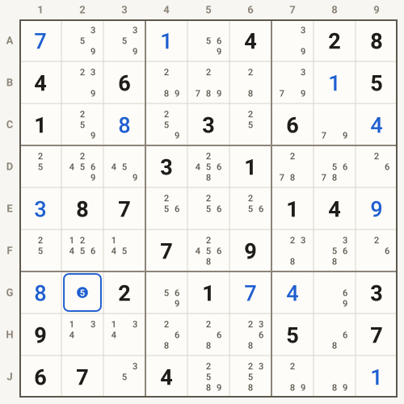

The library puzzle *Naked Singles*, after 1 step.

`G2 = 5 (only candidate)`

> G2 has only one candidate left: it must be 5.
<!-- /example:naked-singles -->

**How the code finds it.** It reads the 81 cells once; each unsolved cell with exactly
one candidate is an occurrence that places that digit, drawn as a disc. All of them are
placed in the same step. Placing a digit also removes it from the candidates of every
cell that sees the cell (`applyStratResult`), which is where most new singles come from.

**Tests.** Only through the puzzle library: every solve starts and ends with singles.

### Hidden Singles

Tried 2nd of 34 · [sudokuwiki.org](https://www.sudokuwiki.org/Getting_Started) · [`hiddenSingles.ts`](../src/core/strategies/hiddenSingles.ts)

A unit has to hold each digit once. When only one of its cells still has a digit as a
candidate, the digit goes there, whatever else that cell could be.

<!-- example:hidden-singles -->
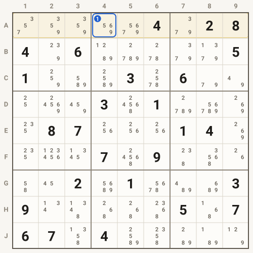

The library puzzle *Naked Singles*, at the start. The step has 11 occurrences; this is one of them.

`A4 = 1 (unique in row A)`

> In row A, only A4 can take a 1: every other cell there already rules it out. So A4 must be 1.
<!-- /example:hidden-singles -->

**How the code finds it.** For each of the 27 units (rows, then columns, then boxes) and
each digit, it lists the unsolved cells of the unit that still have the digit; exactly
one makes an occurrence, placing the digit and washing the unit. A cell can be the last
place for a digit in its row and its box at once, so occurrences are keyed by cell and
digit and only the first unit found is kept.

**Tests.** Only through the puzzle library.

## Intersections

A digit confined to where a line and a box overlap.

### Pointing Pairs

Tried 7th of 34 · [sudokuwiki.org](https://www.sudokuwiki.org/Intersection_Removal) · [`intersections.ts`](../src/core/strategies/intersections.ts)

When a digit's places in a box all lie in one row (or one column), the box's copy of the
digit is in that row. The row cannot have it twice, so it leaves the rest of the row,
outside the box. The places can be two or three cells: pointing pairs and pointing
triples are the same rule.

<!-- example:pointing-pairs -->
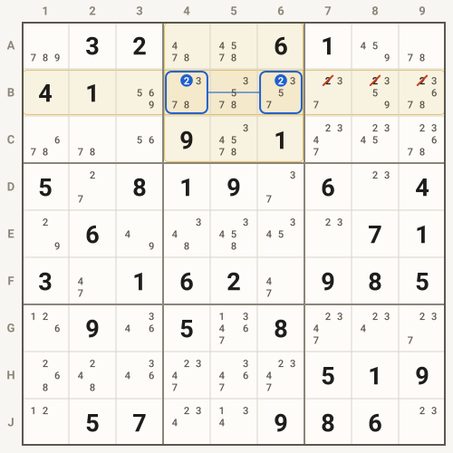

The library puzzle *Pointing Pairs*, at the start. The step has 5 occurrences; this is one of them.

`2 in box 2 locked to row B`

> Inside box 2, the digit 2 fits only in row B. One of those cells must be the 2, so it can't appear anywhere else in row B: the crossed-out candidates are removed.
<!-- /example:pointing-pairs -->

**How the code finds it.** For each box and digit it takes the unsolved cells of the box
that have the digit. Two or three of them, all in one row or all in one column, make an
occurrence when the digit is still somewhere else along that line. One place would be a
hidden single, found earlier. The box and the line are washed, the places get discs and
the removals strokes.

**Tests.** Only through the puzzle library.

### Box-Reduction

Tried 8th of 34 · [sudokuwiki.org](https://www.sudokuwiki.org/Intersection_Removal#LBR) · [`intersections.ts`](../src/core/strategies/intersections.ts)

The reverse of a pointing pair, called box/line reduction on the site. When a digit's
places in a row (or column) all lie in one box, the row's copy of the digit is inside
that box, so no other cell of the box can have it.

<!-- example:box-reduction -->
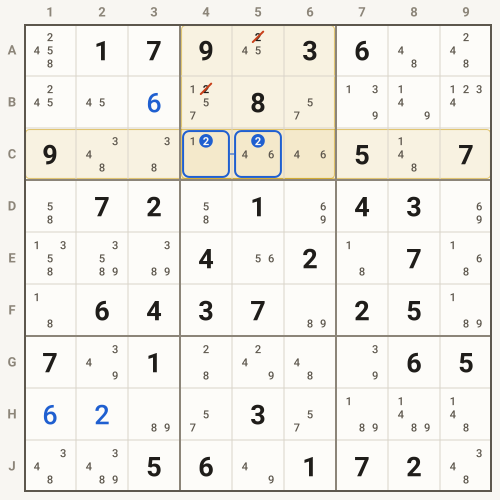

The library puzzle *Box-Reduction*, after 7 steps. The step has 2 occurrences; this is one of them.

`2 in row C locked to box 2`

> In row C, the digit 2 fits only inside box 2. That pins the box's 2 to those cells, so it can be removed from the rest of box 2.
<!-- /example:box-reduction -->

**How the code finds it.** For each row and column, and each digit, it takes the
unsolved cells of the line with the digit. Two or three of them, all in one box, make an
occurrence when the box has the digit elsewhere; those candidates are removed.

**Tests.** Only through the puzzle library.

## Locked sets

N cells that between them must hold exactly N digits, so those digits go from everything the cells see. The first four find the set in one unit; the later ones find it across units, or in cells that are one digit short of a set.

### Naked Pairs

Tried 3rd of 34 · [sudokuwiki.org](https://www.sudokuwiki.org/Naked_Candidates#NP) · [`nakedSets.ts`](../src/core/strategies/nakedSets.ts)

Two cells of a unit with the same two candidates and nothing else: one is the first
digit and the other the second, in some order. Either way both digits are used up in
that unit, so no other cell of the unit can hold them.

The same holds for any N cells of a unit whose candidates, taken together, are N digits:
[Naked Triples](#naked-triples) and [Naked Quads](#naked-quads).

<!-- example:naked-pairs -->
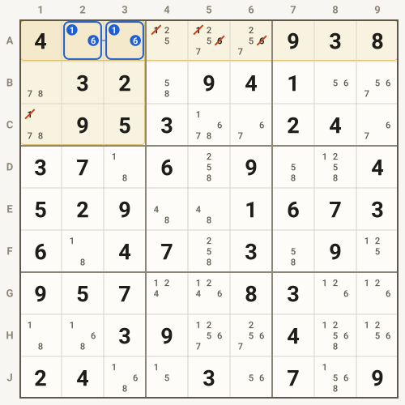

The library puzzle *Naked Pairs*, at the start. The step has 4 occurrences; this is one of them.

`A2/A3 locks 1/6`

> A2 and A3 can each only be 1 or 6. Between them these two cells claim both digits, so no other cell in row A and box 1 can hold them: the crossed-out candidates are removed.
<!-- /example:naked-pairs -->

**How the code finds it.** One function, `nakedSetsForSize`, does pairs, triples and
quads. For each unit it keeps the unsolved cells with between 2 and N candidates, and
tries every combination of N of them (at most 126, for quads in a unit of nine). When
the candidates of the combination add up to exactly N digits and another cell of the
unit has one of them, that is an occurrence: discs on the set's candidates, strokes on
the removals, the unit washed. A pair that shares a row and a box is found in both; the
second find is merged into the first, adding its unit and its removals, so the step
shows one occurrence.

**Tests.** Only through the puzzle library.

### Naked Triples

Tried 4th of 34 · [sudokuwiki.org](https://www.sudokuwiki.org/Naked_Candidates#NT) · [`nakedSets.ts`](../src/core/strategies/nakedSets.ts)

Three cells of a unit whose candidates together are three digits. A cell need not have
all three: 1/2, 2/3 and 1/3 is a naked triple, because those three cells must still take
1, 2 and 3 between them. The three digits leave every other cell of the unit.

<!-- example:naked-triples -->
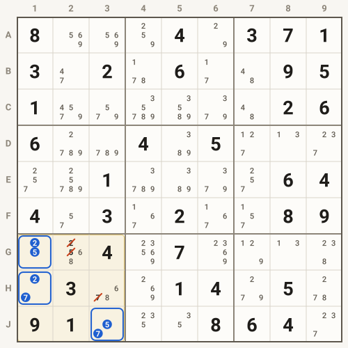

The library puzzle *Naked Triples*, after 1 step.

`G1/H1/J3 locks 2/5/7`

> G1, H1 and J3 can each only be 2, 5 or 7. Between them these three cells claim all three digits, so no other cell in box 7 can hold them: the crossed-out candidates are removed.
<!-- /example:naked-triples -->

**How the code finds it.** As for [Naked Pairs](#naked-pairs), with combinations of
three cells of two or three candidates each.

**Tests.** Only through the puzzle library.

### Hidden Pairs

Tried 5th of 34 · [sudokuwiki.org](https://www.sudokuwiki.org/Hidden_Candidates) · [`hiddenSets.ts`](../src/core/strategies/hiddenSets.ts)

The mirror image of a naked pair. Two digits that, within a unit, fit only in the same
two cells: those two cells must hold those two digits, so any other candidate in them
goes. The pair is "hidden" because the cells still show other candidates until the step
clears them.

<!-- example:hidden-pairs -->
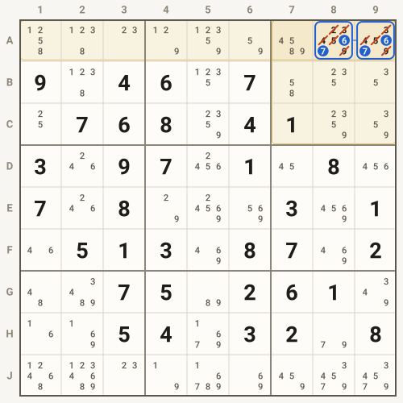

The library puzzle *Hidden Pairs*, at the start.

`digits 6/7 in A8/A9`

> Within row A and box 3, the digits 6 and 7 fit only in A8 and A9. Those cells must hold them, so every other candidate in those cells is crossed out and removed.
<!-- /example:hidden-pairs -->

**How the code finds it.** `hiddenSetsForSize` does pairs, triples and quads. For each
unit and digit it lists the cells where the digit fits; digits with between 2 and N
places are kept. Every combination of N of those digits whose places, together, are
exactly N cells makes a hidden set, and the other candidates of those cells are removed.
Discs mark the set's digits in its cells. The same set seen from a second unit (two cells
in one row and one box) gives the same removals, so it adds its unit to the first
occurrence instead of making another.

**Tests.** Only through the puzzle library.

### Hidden Triples

Tried 6th of 34 · [sudokuwiki.org](https://www.sudokuwiki.org/Hidden_Candidates#HT) · [`hiddenSets.ts`](../src/core/strategies/hiddenSets.ts)

Three digits that within a unit fit only in the same three cells. As with naked triples,
no cell needs all three of them. The three cells hold those digits, so their other
candidates go.

<!-- example:hidden-triples -->
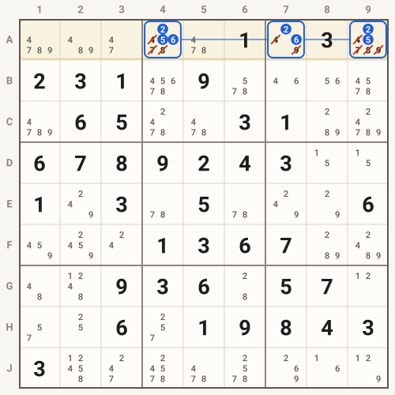

The library puzzle *Hidden Triples*, after 2 steps.

`digits 2/5/6 in A4/A7/A9`

> Within row A, the digits 2, 5 and 6 fit only in A4, A7 and A9. Those cells must hold them, so every other candidate in those cells is crossed out and removed.
<!-- /example:hidden-triples -->

**How the code finds it.** As for [Hidden Pairs](#hidden-pairs), with combinations of
three digits.

**Tests.** Only through the puzzle library.

### Naked Quads

Tried 17th of 34 · [sudokuwiki.org](https://www.sudokuwiki.org/Naked_Candidates#NQ) · [`nakedSets.ts`](../src/core/strategies/nakedSets.ts)

[Naked Pairs](#naked-pairs) with four cells: four cells of one unit whose candidates, taken together, are only four digits. The four cells must hold those four digits between them, so the digits are removed from every other cell of the unit. No cell needs all four; each has two, three or four of them.

<!-- example:naked-quads -->
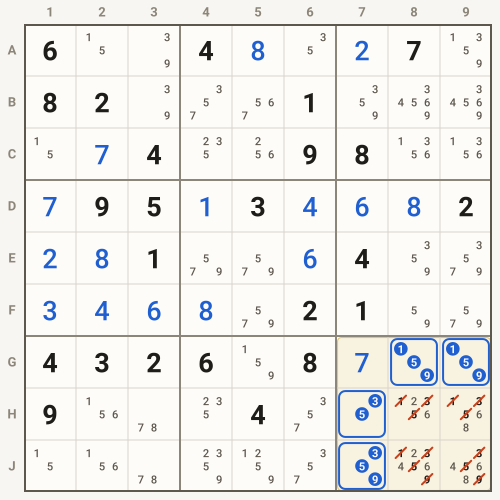

The library puzzle *Naked Quads*, after 14 steps.

`G8/G9/H7/J7 locks 1/3/5/9`

> G8, G9, H7 and J7 can each only be 1, 3, 5 or 9. Between them these four cells claim all four digits, so no other cell in box 9 can hold them: the crossed-out candidates are removed.
<!-- /example:naked-quads -->

**How the code finds it.** The search of [Naked Pairs](#naked-pairs) with a size of four: in each unit, every combination of four unsolved cells with two to four candidates is kept when their candidates make four digits and another cell of the unit loses one. A quad found in two units, a line and a box, is one occurrence.

**Tests.** Only through the puzzle library.

### Hidden Quads

Tried 18th of 34 · [sudokuwiki.org](https://www.sudokuwiki.org/Hidden_Candidates#HQ) · [`hiddenSets.ts`](../src/core/strategies/hiddenSets.ts)

[Hidden Pairs](#hidden-pairs) with four digits: four digits whose places in a unit are the same four cells. Those cells must hold the four digits, so every other candidate in them is removed.

A hidden quad always comes with a naked set in the unit's other unsolved cells, which makes the same removals. With every strategy switched on, Naked Pairs, Triples or Quads find that set first unless it has five cells or more, which is why Hidden Quads so rarely fires.

<!-- example:hidden-quads -->
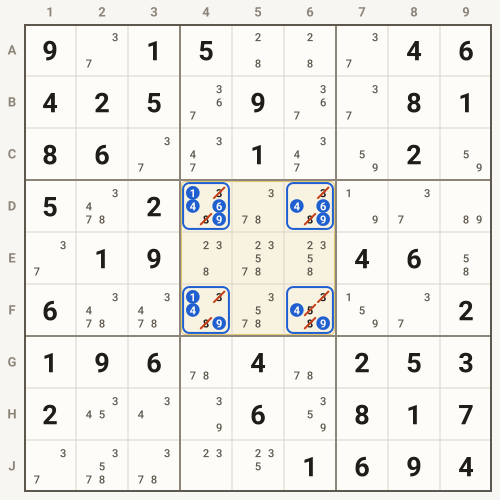

The library puzzle *Hidden Quads*, after 2 steps.

`digits 1/4/6/9 in D4/D6/F4/F6`

> Within box 5, the digits 1, 4, 6 and 9 fit only in D4, D6, F4 and F6. Those cells must hold them, so every other candidate in those cells is crossed out and removed.
<!-- /example:hidden-quads -->

**How the code finds it.** The search of [Hidden Pairs](#hidden-pairs) with a size of four: in each unit with more than four unsolved cells, the digits with two to four places there are listed, and every combination of four of them is kept when their places make exactly four cells and those cells hold another candidate to remove. A quad found in two units is one occurrence.

**Tests.** Only through the puzzle library.

### Fireworks

Tried 28th of 34 · [sudokuwiki.org](https://www.sudokuwiki.org/Fireworks) · [`fireworks.ts`](../src/core/strategies/fireworks.ts)

Take a row and a column that cross in a cell X, inside a box. Suppose that outside the box the row has only one place Y left for a digit, and the column only one place Z. Then the digit is in X, Y or Z: were it in neither Y nor Z, the row would need it inside the box, and so would the column, and the box takes it once, so both would use the one cell they share, X. That is a firework on the digit: three cells, two of which (Y and Z) do not see each other. On its own it removes nothing, but several digits firing from the same crossing make a locked set.

Triple Firework: three digits fire from the same X with the same Y and Z. Each of the three digits is somewhere in those three cells, and three cells hold three digits, so the cells hold those three and nothing else; every other candidate in X, Y and Z goes. In the article's example 3, 7 and 8 can leave box 5 only at F1 in row F and at C4 in column 4, so F4, F1 and C4 hold 3, 7 and 8, and 4, 5 and 6 leave C4.

<!-- example:fireworks-triple -->
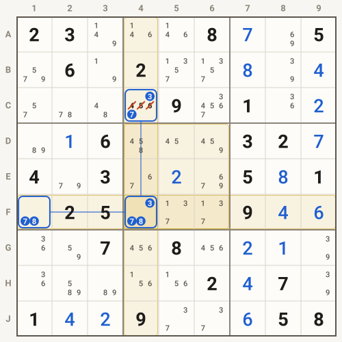

The Triple Firework example of [Fireworks](https://www.sudokuwiki.org/Fireworks) on sudokuwiki.org.

`Triple Firework on 3/7/8: F4 with F1 & C4, eliminates 4/5/6 from C4`

> Outside box 5, row F has no room for 3, 7 or 8 except F1, and column 4 none except C4. Take any of the three: if it is in neither F1 nor C4, row F and column 4 must both place it inside box 5, which takes it once, so it goes where they cross, in F4. Each of 3, 7 and 8 is therefore in F4, F1 or C4: three digits for three cells, so the cells hold those digits and nothing else, and 4, 5 and 6 are removed from C4.
<!-- /example:fireworks-triple -->

Quadruple Firework: two digits fire from X1 and two other digits from X2, where X1 and X2 are opposite corners of a rectangle over four boxes and the other two corners are the outside places of both (the cell in X1's row and X2's column, and the one in X2's row and X1's column). Four digits, each at least once in four cells, so each exactly once. X1 keeps only its own two digits, X2 its two, and the other corners the four.

<!-- example:fireworks-quadruple -->
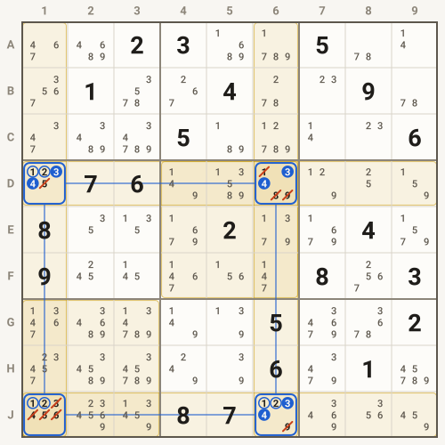

"Cobra Roll" by jovi_al, the Quadruple Firework example of [Fireworks](https://www.sudokuwiki.org/Fireworks) on sudokuwiki.org. Opened after 3 steps of the solver.

`Quadruple Firework on 3/4 and 1/2: D6 & J1 with J6 & D1, eliminates 1/8/9 from D6, 3/4/5/6 from J1, 9 from J6, 5 from D1`

> Outside box 5, row D has no room for 3 or 4 except D1, and column 6 none except J6. A digit in neither of those two cells would have to sit where its row and column cross inside the box, so each of 3 and 4 is in D6, D1 or J6. In the same way, outside box 7, row J has no room for 1 or 2 except J6, and column 1 none except D1, so each of 1 and 2 is in J1, J6 or D1. That is four digits, each at least once in the four cells D6, J1, J6 and D1, so each is there exactly once: D6 can only be 3 or 4, J1 only 1 or 2, and J6 and D1 hold nothing but 1, 2, 3 and 4. So 1, 8 and 9 are removed from D6, 3, 4, 5 and 6 from J1, 9 from J6, 5 from D1.
<!-- /example:fireworks-quadruple -->

**How the code finds it.** For every row and column it lists, digit by digit, the open cells that can take it (none when the digit is already placed in the line). For every open cell X it finds the digits that fire: those whose row has at most one place outside X's box, and whose column has at most one. For a triple, it tries each open cell Y of X's row outside the box and Z of its column outside the box, and keeps the firing digits whose outside places fit Y and Z; three of them, and a check that the three cells can take the three digits one each, make a triple. For a quadruple it pairs crossings in different bands and stacks, each with exactly two firing digits that fit the other two corners, no digit shared between the two sides. A find that removes something is one occurrence: discs on the first crossing's digits, rings on the second's, strokes on the rest of the pattern cells' candidates, ties from each crossing to its two outside places, and each crossing's row, column and box washed.

**Tests.** The article's Triple Firework (exactly 4, 5 and 6 from C4); its "Triple Laser" and "Cobra Roll" quadruple, which the site gives as puzzles only, opened where the strategies tried before X-Cycles first stall (the quadruple's removals match the picture exactly; the Triple Laser's include all five of the picture, plus a few more, as that position holds more candidates). The seven exemplars all solve to the end with Fireworks as a step; a near miss; a sweep over 200 solves.

**Left out.** The weak links a single or double firework gives for alternating inference chains, which this solver does not have.

### SK Loops

Tried 29th of 34 · [sudokuwiki.org](https://www.sudokuwiki.org/SK_Loops) · [`skLoops.ts`](../src/core/strategies/skLoops.ts)

Find four solved cells at the corners of a rectangle over four boxes (two bands, two stacks). Beside each corner, the other two cells of its box in its row make a pair, and the other two in its column another. That gives eight pairs, sixteen cells, going round a loop of eight units: the two rows, the two columns and the four boxes. Each pair lies in one line of the loop and one of its boxes, and each unit of the loop holds two of the pairs.

Now count. A digit goes once in a unit, so the pairs that end up holding a digit never include two pairs of the same unit, and a pair holds a digit at most once. That caps how many of the sixteen cells each digit can fill. When the caps over the nine digits add up to exactly the number of empty cells in the pairs, there is no slack: every digit fills its full quota. A digit that fills its quota must sit inside the loop in certain units, so it goes from the rest of those units; and it cannot sit in a pair that would leave another pair short, so it goes from that pair too. The site writes this as a set of digits per unit, adding up to 16 round the loop, labelled like `2-2-2-2-2-2-2-2`. The Easter Monster, one of the hardest known puzzles, opens with one.

<!-- example:sk-loops -->
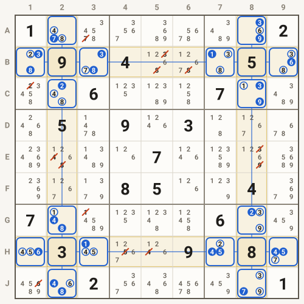

The Easter Monster, the first example of [SK Loops](https://www.sudokuwiki.org/SK_Loops) on sudokuwiki.org, at its start.

`SK Loop 2-2-2-2-2-2-2-2 on B2/B8/H2/H8, eliminates 1 from G3; 2 from C1; 3 from B5, E8; 4 from E2, H5; 5 from H4; 6 from J1; 7 from A3; 8 from B5, B6, E2; 9 from E8`

> B2, B8, H2 and H8 are solved, at the corners of a rectangle over boxes 1, 3, 7 and 9. Beside each corner, the other two cells of its box in its row make a pair, and so do the other two in its column: eight pairs in a loop through those rows, columns and boxes, each pair in one row or column of it and one box. Every candidate in the loop belongs to the digits of its row or column or to those of its box: 2 and 7 in box 1, 3 and 8 in row B, 1 and 6 in box 3, 3 and 9 in column 8, 2 and 7 in box 9, 4 and 5 in row H, 1 and 6 in box 7, 4 and 8 in column 2. That is 16 digits for the 16 empty cells. A digit goes once in a row, column or box, so the loop cannot take more than these, and each cell needs one: every one of them is placed in the loop, inside the unit it is counted in. So each set's digits go from the rest of its row, column or box, 13 candidates in all.
<!-- /example:sk-loops -->

One or two cells of the pairs may already be solved; the count is then over the empty cells only, 14 in the article's third example.

<!-- example:sk-loops-solved-cells -->
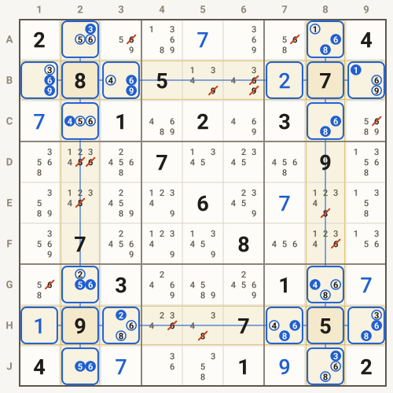

The SK Loop with Solved Cells of [SK Loops](https://www.sudokuwiki.org/SK_Loops) on sudokuwiki.org, after the first four steps of the solve (three Hidden Singles and Pointing Pairs).

`SK Loop 2-2-1-2-2-2-1-2 on B2/B8/H2/H8, eliminates 5 from D2, E2; 6 from A3, A7, B6, C9, D2, F8, G1, H4; 8 from E8, H5; 9 from B5, B6`

> B2, B8, H2 and H8 are solved, at the corners of a rectangle over boxes 1, 3, 7 and 9. Beside each corner, the other two cells of its box in its row make a pair, and so do the other two in its column: eight pairs in a loop through those rows, columns and boxes, each pair in one row or column of it and one box. Every candidate in the loop belongs to the digits of its row or column or to those of its box: 3 and 4 in box 1, 6 and 9 in row B, 1 in box 3, 6 and 8 in column 8, 3 and 4 in box 9, 6 and 8 in row H, 2 in box 7, 5 and 6 in column 2. That is 14 digits for the 14 empty cells (B7 and H1 are solved already). A digit goes once in a row, column or box, so the loop cannot take more than these, and each cell needs one: every one of them is placed in the loop, inside the unit it is counted in (6 could as well be counted in boxes 1, 3, 7 and 9, for the same total, so it is placed there too). So each set's digits go from the rest of its row, column or box, 14 candidates in all.
<!-- /example:sk-loops-solved-cells -->

**How the code finds it.** It treats the eight pairs as the edges of a ring of eight units. For a digit, the pairs that hold it are a set of edges; the pairs that hold it in the solution share no unit, a matching, so its quota is the size of the largest matching. Two tables are built once, for each of the 256 sets of edges: that size, the units every largest matching touches, and the edges some largest matching uses. On a call it tries every two rows in different bands and two columns in different stacks whose four crossings are solved, lists the eight pairs in loop order, and sums the quotas of the nine digits. Only a sum equal to the number of empty pair cells goes on. Then each digit leaves, outside the loop, every unit that all its largest matchings touch, and leaves every pair that none of them uses; this is a little stronger than the site's rule. Loops with the same removals are dropped. For the label each digit is counted in one smallest set of units, rows and columns first as the site does, so the label shows the site's type. In each pair, digits counted in one of its units are discs and those counted in the other rings, removals are struck, and the two rows and two columns are washed.

**Tests.** The article's three examples, which it gives as puzzles only: each position is where this solver stalls on that puzzle, stored in the test, and each checks the corners, the site's type label (`2-2-2-2-2-2-2-2`, `3-1-3-1-3-1-3-1`, `2-2-1-2-2-2-1-2`), the sets and every removal, including the Easter Monster's 3 and 8 from B5 and B6. Near misses (one candidate too many, an unsolved corner), the Easter Monster turned on its side, and a sweep over 200 solves.

**Left out.** The site's related loops and the wider forms in its comments (escape cells, counts over clues without the rectangle). The article says a corner is a clue, not a solved cell; the count holds for any solved corners, and the code does not check.

### Twinned XY-Chains

Tried 30th of 34 · [sudokuwiki.org](https://www.sudokuwiki.org/Twinned_XY_Chains) · [`twinnedXyChains.ts`](../src/core/strategies/twinnedXyChains.ts)

Nils Leder's pattern: six cells where two rows cross three columns (or two columns cross three rows), holding six digits between them, such that each digit's places among the six cells all see one another. Then no digit can be in two of the six cells. Six cells need six different digits and only six are on offer, so each digit is in exactly one of its places, and a cell outside that sees all the places of a digit cannot be that digit. The cells need not be in different boxes, and need not have two candidates each.

The name comes from Nils's first reading of it: with one extra candidate gone, four of the cells would make an XY-Chain loop on four digits; with another gone, a different four would make a loop on four others. One of the two loops must be live, and either one switches on the other. The locked set view says the same more directly, and also covers the article's third example, where three digits run along the rows and three down the columns.

In the first example E1, E5, E9, J1, J5 and J9 hold 1 to 6: 1 only in E1 and J1 (column 1), 2 in J1 and J5 (row J), 3 in E5 and J5 (column 5), 4 in E1, E5 and E9 (row E), 5 in J5 and J9 (row J), 6 in E9 and J9 (column 9). So 1 goes from the rest of column 1, 3 from the rest of column 5, and so on: nine candidates in all.

<!-- example:twinned-xy-chains -->
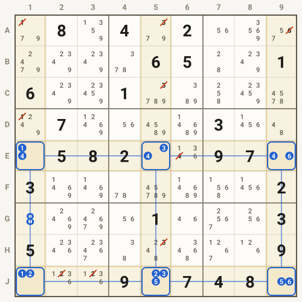

Nils Leder's example, the first of [Twinned XY-Chains](https://www.sudokuwiki.org/Twinned_XY_Chains) on sudokuwiki.org.

`Twinned XY-Chains on 1/2/3/4/5/6: rows E&J, columns 1&5&9, eliminates 1 from A1, D1; 2 from J2, J3; 3 from A5, C5, H5; 4 from E6; 6 from A9`

> E1, E5, E9, J1, J5 and J9 hold six digits between them, 1, 2, 3, 4, 5 and 6, and wherever a digit can go among them, those places see one another: 1 in E1 and J1 (column 1), 2 in J1 and J5 (row J), 3 in E5 and J5 (column 5), 4 in E1, E5 and E9 (row E), 5 in J5 and J9 (row J), 6 in E9 and J9 (column 9). So no digit can be in two of the six cells, and six cells need six different digits: each digit is in exactly one of its places here. It works like two XY-Chain loops twinned on the cells they share, one of which must hold. A cell outside that sees every place of a digit cannot be that digit, so 1 is removed from A1 and D1; 2 from J2 and J3; 3 from A5, C5 and H5; 4 from E6; 6 from A9.
<!-- /example:twinned-xy-chains -->

**How the code finds it.** Each open cell's candidates become a bit mask. For both orientations it takes each pair of lines and, for each line the other way, joins the masks of the two cells where it crosses them; a crossing is unusable when either cell is solved or the two already hold more than six digits. It then chooses three usable crossings in order, stopping early when the first two already hold more than six digits, and keeps the six cells when they hold exactly six. Six cells inside one box are an ordinary naked set, found long before, and are skipped. For each of the six digits, every two of its places among the six cells must see each other, or the formation is dropped. The targets of a digit are the open cells outside the six that hold it and see all its places. Each formation is visited once, so there are no duplicates. Discs mark every candidate of the six cells, strokes the targets; ties join consecutive places of each digit, and the units those places share are washed.

**Tests.** All three of the article's examples remove exactly the candidates their pictures mark (nine, seven and six), a reader's position from the comments is sound, two near misses each break example 1's formation, the three article puzzles are solved with it as a step, and a sweep over 200 solves.

**Left out.** A reader's generalisation in the comments: any N cells holding N digits whose places see one another, whatever their shape. It is sound, but it is not the article's pattern, and its search is much larger.

### Aligned Pair Exclusion

Tried 34th of 34 · [sudokuwiki.org](https://www.sudokuwiki.org/Aligned_Pair_Exclusion) · [`alignedPairExclusion.ts`](../src/core/strategies/alignedPairExclusion.ts)

Take two unsolved cells, the base pair, and list every way they could be filled: a candidate of the first with a candidate of the second. Some of those combinations can be ruled out. When a digit of one base cell is left with no partner in the other, it is removed.

Two things rule a combination out. The same digit twice: when the base cells see each other (an aligned pair) they cannot hold the same digit. And a set left too short. An almost locked set is N cells of one unit holding N + 1 digits between them; the smallest is one cell with two candidates. Fill one base cell with a and the other with b. If every cell of the set holding a sees the first base cell, and every cell holding b sees the second, the set loses both digits and is left with N - 1 digits for N cells, which cannot be. For a two-candidate cell this says the base pair cannot be exactly that cell's two digits.

In the article's first example G2 holds 2/4 and G3 holds 2/5/8, in row G. G9 holds only 2/8 and H1 only 4/8, and both see G2 and G3. G3 = 8 would need G2 to be 2 or 4: 2 with 8 empties G9, and 4 with 8 empties H1. So 8 has no partner and leaves G3.

<!-- example:aligned-pair-exclusion -->
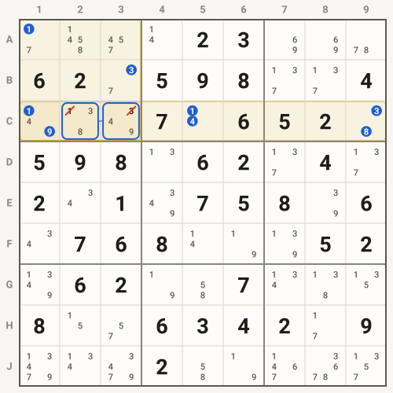

Example 2 of [Aligned Pair Exclusion](https://www.sudokuwiki.org/Aligned_Pair_Exclusion) on sudokuwiki.org. The step has 9 occurrences; this is one of them.

`Aligned pair C2/C3 with C1+C5, C5, C9, A1+B3: eliminates 1 from C2, 3 from C3`

> C2 and C3 share row C, so they hold two different digits. A pair of digits for them is ruled out when it would leave cells that see them with too few digits to go round. If C2 were 1, C3 could be none of 3, 4 and 9: not 3, as A1 and B3, which between them can only be 1, 3 or 7, would be left with only 7 for two cells; not 4, as C5, which can only be 1 or 4, would be left empty; not 9, as C1 and C5, which between them can only be 1, 4 or 9, would be left with only 4 for two cells. If C3 were 3, C2 could be none of 1, 3 and 8: not 1, as A1 and B3, which between them can only be 1, 3 or 7, would be left with only 7 for two cells; not 3, the digit C3 would hold; not 8, as C9, which can only be 3 or 8, would be left empty. So 1 is removed from C2, and 3 from C3.
<!-- /example:aligned-pair-exclusion -->

When the base cells do not see each other (an unaligned pair) the same digit in both is allowed, and the rest of the reasoning holds unchanged.

<!-- example:aligned-pair-exclusion-unaligned -->
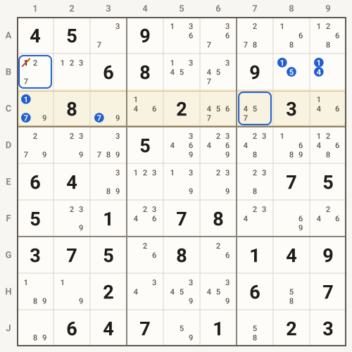

Example 5 of [Aligned Pair Exclusion](https://www.sudokuwiki.org/Aligned_Pair_Exclusion) on sudokuwiki.org. Its link gives only the digits; the candidates here are what the basic strategies leave. The step has 12 occurrences; this is one of them.

`Unaligned pair B1/C7 with B8, B9, C1+C3: eliminates 1 from B1`

> B1 and C7 do not see each other, so they could even hold the same digit. A pair of digits for them is ruled out when it would leave cells that see them with too few digits to go round. If B1 were 1, C7 could be none of 4, 5 and 7: not 4, as B9, which can only be 1 or 4, would be left empty; not 5, as B8, which can only be 1 or 5, would be left empty; not 7, as C1 and C3, which between them can only be 1, 7 or 9, would be left with only 9 for two cells. So 1 is removed from B1.
<!-- /example:aligned-pair-exclusion-unaligned -->

**How the code finds it.** Candidates become bit masks. Every almost locked set of one to four cells is listed unit by unit, growing sets cell by cell and dropping a branch once it holds more than five digits; a set in a line and a box at once is kept once. For each set and each of its digits, the code records the cells outside it that hold the digit and see every cell of the set holding it. Turned round, this gives for each cell and digit the sets that would lose that digit if the cell took it. Then, for each cell and digit to test, it walks those sets and marks, for every other digit of each set, the cells that would lose that digit too. A cell whose candidates are all marked (with the tested digit itself counted when the cell sees the tested one) has no partner left, so the tested digit goes. This finds every removal in one pass, without listing base pairs first. Removals are grouped by base pair, and the explanation gives, for each partner digit, the smallest set that rules it out. Occurrences come simplest first (fewer cells in their sets, smaller sets, an aligned pair, more removed); one is dropped when an earlier one already makes its removals, and a step shows at most 12. The base pair is outlined, the candidates each set would lose are discs, and removals in the base cells are struck.

**Tests.** Examples 1 to 3 (aligned), 4 to 6 (unaligned) and the eight-cell example, which the code reaches with four two-candidate cells of the eight. Examples 1, 4, 5 and 6 are given on the site as digits only, so their candidates are rebuilt and the basic strategies run first. On example 6 the step names B1/D1 with A3, D3, E3 and F3 where the site names A3/D1: the same six cells read the other way round, with the same removal. Near misses, four article puzzles solved from the start, and a sweep over 200 solves.

**Left out.** Sets of five cells or more, which cost more to search for little gain.

## Fish

One digit confined to N lines one way and N lines the other.

### X-Wing

Tried 10th of 34 · [sudokuwiki.org](https://www.sudokuwiki.org/X_Wing_Strategy) · [`fish.ts`](../src/core/strategies/fish.ts)

Take one digit and two rows in which it has exactly two places left, and suppose those places are in the same two columns. The four cells are the corners of a rectangle. Each row needs the digit once, and the two rows cannot take it from the same column, so the digit sits on two opposite corners: top left and bottom right, or top right and bottom left. Either way each of the two columns gets its digit from these two rows, so the digit is removed from every other cell of the two columns.

The same holds with rows and columns swapped: two columns with two places each, in the same two rows, clear the digit from the rest of those rows.

<!-- example:x-wing -->
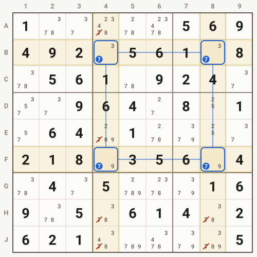

The library puzzle *X-Wing*, after 2 steps.

`X-Wing on 7: rows B&F, columns 4&8, eliminates 7 from A4, E4, H4, J4, H8, J8`

> The only places for 7 in rows B and F are columns 4 and 8: four corners of a rectangle. The two 7s must sit on opposite corners, so every other 7 in those columns is removed.
<!-- /example:x-wing -->

**How the code finds it.** X-Wing, Swordfish and Jellyfish are one search, run with a size N of 2, 3 or 4. For each digit, rows are the base lines first, then columns. The code lists the base lines in which the digit has from 2 to N places (a line with one place is a hidden single). Every combination of N of those lines is tried: the columns their places fall in, the cover lines, are collected, and the combination counts only if there are exactly N of them. The digit is then removed from every cell of the cover lines outside the pattern, and a combination that removes nothing is dropped. Each fish is one occurrence: discs on the digit in the pattern cells, strikes on the removals, the base and cover lines washed, and ties between the pattern cells along those lines.

**Tests.** Only through the puzzle library, where every step of every library solve is checked against the solution.

**Left out.** Finned fish (Finned X-Wing, Finned Swordfish) are in sudokuwiki.org's extreme tier; fish over boxes are not tried.

### Swordfish

Tried 19th of 34 · [sudokuwiki.org](https://www.sudokuwiki.org/Sword_Fish_Strategy) · [`fish.ts`](../src/core/strategies/fish.ts)

The [X-Wing](#x-wing) with three lines. Take one digit and three rows in which all its places fall inside the same three columns. Each row has two or three places; together they need not fill all nine crossings. The three rows need three of the digit and no two can share a column, so each of the three columns gets its digit from these rows, and the digit is removed from the rest of those columns. Rows and columns can be swapped.

<!-- example:swordfish -->
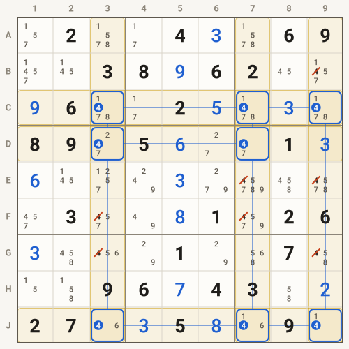

The library puzzle *Swordfish*, after 13 steps. The step has 2 occurrences; this is one of them.

`Swordfish on 4: rows C&D&J, columns 3&7&9, eliminates 4 from F3, G3, E7, F7, B9, E9, G9`

> In rows C, D and J, every possible 4 falls inside columns 3, 7 and 9. Those three columns must take their 4s from these rows, so 4 is removed from the rest of those columns.
<!-- /example:swordfish -->

**How the code finds it.** The [X-Wing](#x-wing) search with N = 3: base lines with two or three places for the digit, every combination of three of them, and exactly three cover lines between them.

**Tests.** Only through the puzzle library.

### Jellyfish

Tried 24th of 34 · [sudokuwiki.org](https://www.sudokuwiki.org/Jelly_Fish_Strategy) · [`fish.ts`](../src/core/strategies/fish.ts)

The [X-Wing](#x-wing) and [Swordfish](#swordfish) with four lines: one digit whose places in four rows all fall inside the same four columns. The four rows need four of the digit, one in each column, so the digit is removed from the rest of those columns, or the same with rows and columns swapped. Each base line has two to four places.

<!-- example:jellyfish -->
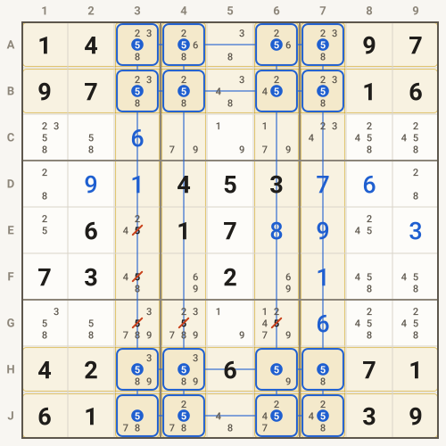

The library puzzle *Jellyfish*, after 10 steps. The step has 4 occurrences; this is one of them.

`Jellyfish on 5: rows A&B&H&J, columns 3&4&6&7, eliminates 5 from E3, F3, G3, G4, G6`

> In rows A, B, H and J, every possible 5 falls inside columns 3, 4, 6 and 7. Those four columns must take their 5s from these rows, so 5 is removed from the rest of those columns.
<!-- /example:jellyfish -->

**How the code finds it.** The [X-Wing](#x-wing) search with N = 4.

**Tests.** Only through the puzzle library.

## Wings

A few cells with two or three candidates each that between them must hold a digit.

### Y-Wing

Tried 13th of 34 · [sudokuwiki.org](https://www.sudokuwiki.org/Y_Wing_Strategy) · [`wings.ts`](../src/core/strategies/wings.ts)

Three cells with two candidates each: a hinge holding X and Y, and two pincers that the hinge sees, one holding X and Z, the other Y and Z. Whichever digit the hinge turns out to be, one pincer loses it and is left with Z: if the hinge is X the XZ pincer is Z, and if it is Y the YZ pincer is Z. So one of the two pincers is Z, and any cell that sees both pincers cannot be Z. Also known as XY-Wing.

The pincers must not see each other. If they did, all three cells would share a unit and form a naked triple, which is found earlier.

<!-- example:y-wing -->
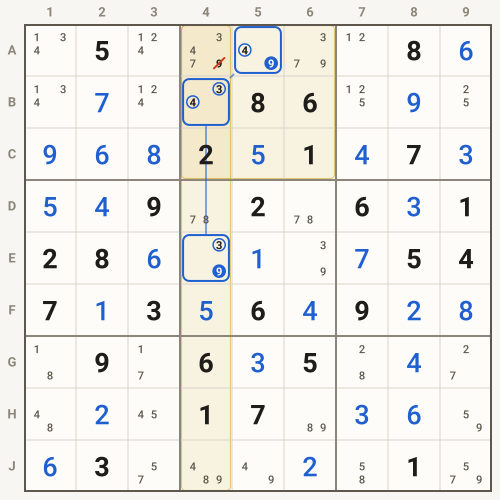

The library puzzle *Y-Wing*, after 11 steps. The step has 3 occurrences; this is one of them.

`Y-Wing on 9: hinge B4, pincers A5 & E4, eliminates 9 from A4`

> B4 can only be 3 or 4. It shares box 2 with A5 (4 or 9) and column 4 with E4 (3 or 9), so if B4 is 4 then A5 is 9, and if B4 is 3 then E4 is 9. Either way one of A5 and E4 is 9, so 9 is removed from A4, which sees both of them.
<!-- /example:y-wing -->

**How the code finds it.** Y-Wing and XYZ-Wing are one search. Every cell with two candidates is tried as the hinge. Its possible pincers are the cells it sees that have two candidates, exactly one of them shared with the hinge. Every two of those pincers are paired: they must not see each other, they must share exactly one digit Z, and the hinge must not hold Z. Two pincers that take the same digit from the hinge share two digits and are skipped by that check. The targets are the cells that see both pincers and still hold Z; a wing without targets is dropped. Each wing is one occurrence: discs on the two Zs, rings on the digit that ties the hinge to each pincer, strikes on the Zs removed, ties from the hinge to each pincer, and the units the hinge shares with each pincer washed (their box when they share one, otherwise their line).

**Tests.** Examples 1 to 3 of the article and both wings of its Double Y-Wing, the article's exemplars 1 to 6 solved with Y-Wing and the basic strategies alone, a sweep over every position of 200 solves, and near misses: a pincer out of sight of the hinge, three cells that are not a Y-Wing, and no target holding Z.

### W-Wing

Tried 14th of 34 · [sudokuwiki.org](https://www.sudokuwiki.org/W_Wing_Strategy) · [`wWing.ts`](../src/core/strategies/wWing.ts)

Two cells that do not see each other hold the same two candidates, X and Y. Now find a strong link on Y: a unit where Y has only two places, one of them in sight of the first cell and the other in sight of the second. The two cells cannot both be Y: each would rule out the end of the link it sees, and that unit would be left without a Y. So at least one of them is X, and X is removed from every cell that sees both.

When the two cells are joined for both digits, they cannot both be X and cannot both be Y, so one is X and the other Y, and a cell that sees both can be neither. Two forms of this are found. The double, or Remote Pair chain: two more cells with the same pair, which see each other and each see one of the two cells, so the digits alternate along a chain of four. The split double: a strong link of its own for each digit.

<!-- example:w-wing -->
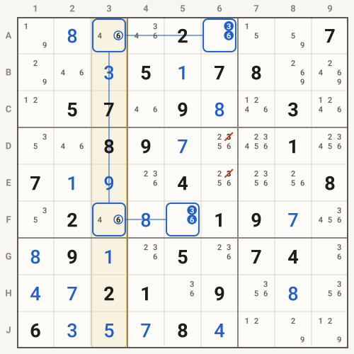

The library puzzle *W-Wing*, after 9 steps. The step has 3 occurrences; this is one of them.

`W-Wing on 3/6: A6/F5 linked by 6 in A3/F3, eliminates 3 from D6, E6`

> A6 and F5 can each only be 3 or 6. They cannot both be 6: the only places for 6 in column 3 are A3 and F3, and A3 sees A6 while F3 sees F5, so column 3 would be left without a 6. One of them is therefore 3, so 3 is removed from D6 and E6, which see both of them.
<!-- /example:w-wing -->

**How the code finds it.** Cells with exactly two candidates are grouped by their pair. Within a group, two cells that see each other make a link of the double, since they take one digit each. The strong links of a digit (every row, column and box with exactly two places for it) are worked out the first time that digit is needed. Then every two cells of a group that do not see each other are tried. The double comes first: a link between two other cells of the group, one end in sight of each cell. Otherwise, for each digit of the pair, the code looks for a strong link on the other digit with one end in sight of each cell. A cell does not count as seeing itself, so a link never starts at one of the two cells. The targets are the cells that see both and hold the digit. One occurrence covers the two cells, whichever links joined them: discs on both cells' digits, rings on the link ends, strikes, ties from each cell through the link to the other, and the links' units washed.

**Tests.** The article's two doubles, two singles and both split doubles, the two W-Wings of its diabolical puzzle, a sweep over every position of 200 solves, and near misses: a link with a third place in its unit, a link end in sight of neither cell, no cell that sees both, two cells that see each other, and the same step a second time.

**Left out.** Remote Pair chains longer than four cells (six, eight). [XY-Chain](#xy-chain) finds them, later in the order.

### XYZ-Wing

Tried 20th of 34 · [sudokuwiki.org](https://www.sudokuwiki.org/XYZ_Wing) · [`wings.ts`](../src/core/strategies/wings.ts)

A [Y-Wing](#y-wing) whose hinge holds Z as well: the hinge has X, Y and Z, and sees two pincers holding X and Z, and Y and Z. If the hinge is X the XZ pincer is Z, if it is Y the YZ pincer is Z, and otherwise the hinge is Z itself. One of the three cells is Z, so Z is removed from any cell that sees all three. Such a cell shares the hinge's box, so there are at most two of them.

<!-- example:xyz-wing -->
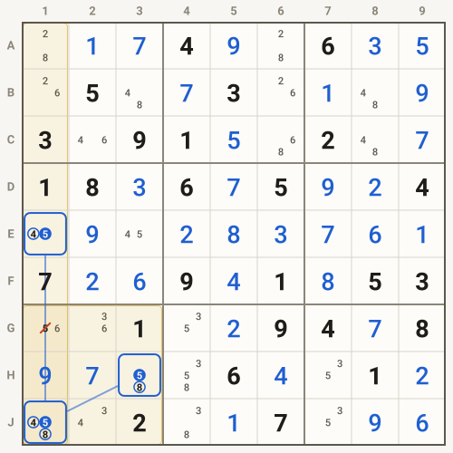

The library puzzle *XYZ-Wing*, after 15 steps.

`XYZ-Wing on 5: hinge J1, pincers E1 & H3, eliminates 5 from G1`

> J1 can only be 4, 5 or 8. It shares column 1 with E1 (4 or 5) and box 7 with H3 (5 or 8), so if J1 is 4 then E1 is 5, and if J1 is 8 then H3 is 5; otherwise J1 is 5 itself. Either way one of the three cells is 5, so 5 is removed from G1, which sees all three.
<!-- /example:xyz-wing -->

**How the code finds it.** The [Y-Wing](#y-wing) search with a hinge of three candidates and pincers whose two candidates are both the hinge's. The pincers must not see each other and must share exactly one digit, Z. The targets must see the hinge as well as both pincers. The marks are the Y-Wing's, with a disc on the hinge's Z too.

**Tests.** Examples 1 and 2 of the article, its exemplars 1, 2, 3, 6 and 8 solved with XYZ-Wing and the basic strategies alone, a sweep over every position of 200 solves, and near misses, among them a check that no Y-Wing is taken for an XYZ-Wing or the other way round.

### WXYZ-Wing

Tried 33rd of 34 · [sudokuwiki.org](https://www.sudokuwiki.org/WXYZ_Wing) · [`wxyzWing.ts`](../src/core/strategies/wxyzWing.ts)

A bent [naked quad](#naked-quads): four cells that between them hold only four digits, but do not all sit in one row, column or box. They lie in two units that cross: a row or column and a box, or (since the site's August 2025 update) a row and a column. What matters is whether a digit is restricted: every place it has among the four cells sees every other, so it can be used at most once in them. A digit whose places do not all see each other could in principle be used twice.

Type 1: exactly one digit, Z, is not restricted. If none of the four cells were Z, they would have to be filled from the other three digits, each used at most once: three digits for four cells cannot be done. So one of the cells holding Z is Z, and a cell outside the four that sees every one of them loses Z. [XYZ-Wing](#xyz-wing) is the three-cell form of the same argument.

<!-- example:wxyz-wing -->
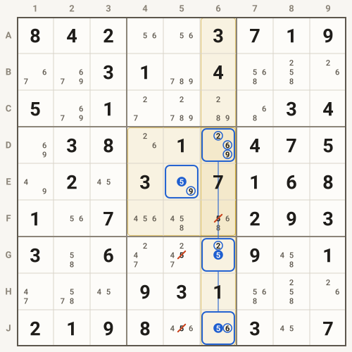

Example 2 of [WXYZ-Wing](https://www.sudokuwiki.org/WXYZ_Wing) on sudokuwiki.org.

`WXYZ-Wing on 5: D6/E5/G6/J6 hold 2/5/6/9, eliminates 5 from F6, G5, J5`

> D6, E5, G6 and J6 each lie in column 6 or box 5, and between them hold only 2, 5, 6 and 9. The 2s, 6s and 9s each sit only in cells that see one another, so none of them can be used twice in these four cells. Were none of the four 5, they would have three digits for four cells, so at least one of E5, G6 or J6 is 5. F6, G5 and J5 see all of them, so 5 is removed from them.
<!-- /example:wxyz-wing -->

Type 2: all four digits are restricted. Four cells, four digits, each used at most once, so each is used exactly once, as in a naked quad, though the cells share no unit. For each digit, a cell outside the four that sees all its places loses it, and several digits can remove in one step.

<!-- example:wxyz-wing-type-2 -->
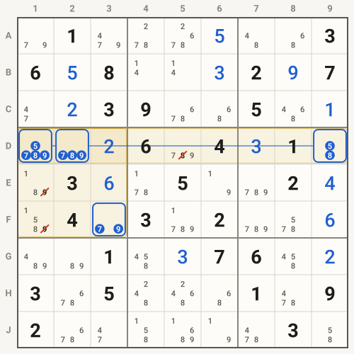

The first Type 2 example of [WXYZ-Wing](https://www.sudokuwiki.org/WXYZ_Wing) on sudokuwiki.org. The step has 3 occurrences; this is one of them.

`WXYZ-Wing (Type 2): D1/D2/D9/F3 hold 5/7/8/9, eliminates 8 from D5; 9 from E1, F1`

> D1, D2, D9 and F3 each lie in row D or box 4, and between them hold only 5, 7, 8 and 9. Each of these digits sits only in cells that see one another, so none can be used twice. Four cells and four digits, each used at most once: every digit is in exactly one of them, as in a naked quad, though the cells do not share one unit. D5 sees every 8 of the four, so it loses its 8. E1 and F1 see every 9 of the four, so they lose their 9.
<!-- /example:wxyz-wing-type-2 -->

**How the code finds it.** Candidates become bit masks, and only open cells with two to four candidates can take part. The four cells always fit in two crossing units, so the search runs inside each of the 135 crossing pairs (each row or column with each box it meets, and each row with each column), at most 17 cells each, instead of over the whole board. Within a region, sets of four cells are grown in board order, and a branch stops as soon as its cells hold more than four digits; a set found in two regions is kept once. A set with exactly four digits that lies inside one unit is a naked quad, which comes earlier, and is skipped. For each digit the code checks whether its places all see each other: two or more loose digits, no wing; one, Type 1 on that digit; none, Type 2 on every digit. A digit's targets are the peers of its first place that hold it, are not in the set, and see every other place. Sets with the same removals are reported once. Type 1 puts discs on the Zs and rings on the other digits; Type 2 discs on every candidate of the four; removals are struck and the two crossing units washed.

**Tests.** Type 1 examples 1 to 4 (the fourth is the row and column form) and two reader positions from the comments, Type 2 examples 1 and 2, near misses (two loose digits, five digits in four cells, a set inside one unit, four cells in units that do not cross), example 3's puzzle solved from the start, and a sweep over 200 solves.

**Left out.** Nothing of the article's two types. Sets inside one unit are left to Naked Quads.

## Chains

Links that force one candidate or another, followed from cell to cell.

### Chute Remote Pairs

Tried 12th of 34 · [sudokuwiki.org](https://www.sudokuwiki.org/Chute_Remote_Pairs) · [`chuteRemotePairs.ts`](../src/core/strategies/chuteRemotePairs.ts)

A chute is three boxes in a line: a band across the grid or a stack down it. Take two cells with the same two candidates, X and Y, in one chute but in different boxes, and out of sight of each other (a remote pair, not a naked pair). They sit on two of the chute's three lines. The chute's third box has three cells on the remaining line, and neither cell of the pair sees them.

Suppose X is nowhere in those three cells, neither as a candidate nor as a placed digit. If both cells of the pair were X, the two lines they are on would have their X, and the third box could only put its X on the third line, where there is none. So the pair is not X twice: at least one of them is Y, and Y is removed from every cell that sees both.

When neither X nor Y is in the three cells (the double), the third box has to put X and Y on the pair's two lines, one on each, since both on one line would leave that line's cell of the pair with neither digit. On each of those lines one digit is then in the third box and the other in the pair's cell, so both digits go from the rest of the two lines. The article calls the removals beyond the cells that see both the 'either end' rule.

<!-- example:chute-remote-pairs -->
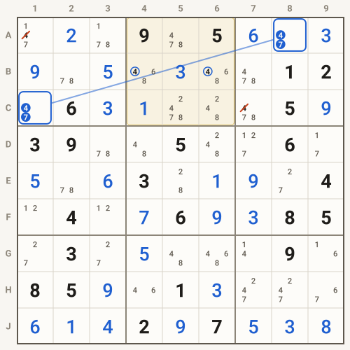

The library puzzle *Chute Remote Pairs*, after 14 steps.

`A8/C1 remote pair 4/7, no 7 in B4/B5/B6, eliminates 4 from A1, C7`

> A8 and C1 can each only be 4 or 7, and they share no row, column or box. If both were 7, rows A and C would have their 7, leaving box 2 only row B for its own, but B4, B5 and B6 cannot be 7. So at least one of the two is 4, and 4 is removed from the cells that share a row, column or box with both.
<!-- /example:chute-remote-pairs -->

**How the code finds it.** The cells with two candidates are listed, and every two with the same pair that do not see each other are tried. If their rows lie in one band the chute runs along rows; if their columns lie in one stack, along columns; otherwise they are not in a chute. The third line comes from arithmetic: a chute's lines are 3k, 3k+1 and 3k+2, so the third is 9k + 3 minus the other two. The three cells are the ones on it outside the pair's two boxes, and a digit of the pair counts as present when one of them holds it as a candidate or as a value. With one digit missing, the targets are the cells that see both cells of the pair, and they lose the other digit. With both missing, the targets are the rest of the pair's two lines outside the third box, and they lose both. A pair with nothing to remove is dropped. Each pair is one occurrence: discs on both cells' digits, rings on the digits the three cells can still take, strikes, a tie between the two cells, and the third box washed, with the pair's two lines too for the double.

**Tests.** The article's five worked examples (three singles, the double and the 'either end' removals), the same pattern along columns, a case built by hand for each rule and near miss (cells that see each other, both digits present, not one chute, nothing to remove, a solved cell among the three), a sweep over 300 generated puzzles, and the article's ten exemplar puzzles.

### Rectangle Elimination

Tried 15th of 34 · [sudokuwiki.org](https://www.sudokuwiki.org/Rectangle_Elimination) · [`rectangleElimination.ts`](../src/core/strategies/rectangleElimination.ts)

One digit and three of its places: a hinge and two wings. The hinge and the first wing are the only two places for the digit in their row, so one of them holds it: a strong link. The second wing shares the hinge's column, where the digit has more places. Each wing is in a different box from the hinge, which makes the three cells corners of a rectangle whose fourth corner lies in a fourth box.

Suppose the second wing were the digit. The hinge, in the same column, would not be, so the first wing would be. The two wings look into the fourth box along a row and a column, and if between them they see every place that box has for the digit, the box would be left without it. So the second wing is not the digit, and the candidate is removed. The same holds with the strong link along a column and the second wing along the row. When the hinge's second line is a strong link as well, the argument runs both ways and both wings lose the digit.

The pattern comes from Ken Reek and replaced Empty Rectangles on sudokuwiki.org.

<!-- example:rectangle-elimination -->
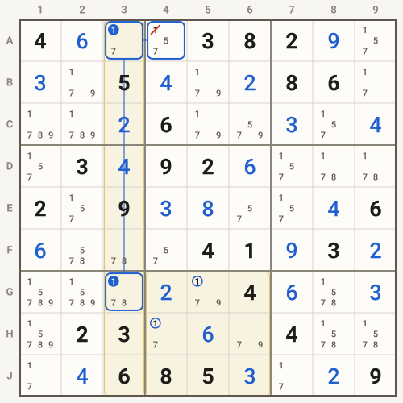

The library puzzle *Rectangle Elimination*, after 6 steps. The step has 5 occurrences; this is one of them.

`Rectangle on 1: hinge A3, wings G3 and A4, box 8, eliminates 1 from A4`

> In column 3, the digit 1 fits only in A3 and G3, so if A3 isn't the 1 then G3 is. A 1 in A4 would rule out A3, also in row A, and so force G3, and between them A4 and G3 would cross out every 1 in box 8 (G5 and H4). A box can't be left without its 1, so A4 can't be 1 and the candidate is removed.
<!-- /example:rectangle-elimination -->

**How the code finds it.** One digit at a time, the code lists the digit's places by row, by column and by box. Every place is tried as the hinge, which needs its row or its column to hold exactly two places. The strong link runs along the row when the row is a pair and along the column otherwise, so a hinge with a pair both ways is one pattern, not two. The strong wing must lie outside the hinge's box. Every other place on the hinge's other line, outside the hinge's box, is tried as the second wing. The fourth corner is the cell in the second wing's row and the strong wing's column (or the other way round), and every place for the digit in that corner's box must be in sight of one of the two wings. A box with no places left, its digit already placed, does not count. Each hinge and second wing is one occurrence: discs on the cells kept, rings on the fourth box's places, a strike on each wing removed, ties from the hinge to both wings, and the strong line and the fourth box washed, with the other line too when both lines are strong.

**Tests.** The article's examples (hinge G2 along a row, hinge F4 along a column, several wings off one hinge, the same three cells for two digits, two strong links) and its extended chain variant, which is not this rule; a sweep over 200 generated puzzles; and near misses: a third place along the hinge's line, a place in the fourth box out of sight of both wings, a wing in the hinge's box, and the same step a second time.

### Simple Colouring

Tried 16th of 34 · [sudokuwiki.org](https://www.sudokuwiki.org/Simple_Colouring) · [`simpleColouring.ts`](../src/core/strategies/simpleColouring.ts)

Take one digit. Wherever a row, column or box has only two places left for it, one of them holds it and the other does not: a strong link. These links join into chains. Give the cells of a chain two colours in turn, here discs and rings: the colour changes along every link, so one colour is all the digit and the other has none of it. Which colour is true is not known yet, but three rules can decide it, or remove candidates anyway. The strategy is also known as Singles Chains.

Rule 2, twice in a unit: two cells of the same colour in one row, column or box would put the digit there twice, so that colour is false. Its candidates are removed and the other colour is the solution.

Rule 4, two colours elsewhere: a cell off the chain that sees a cell of each colour cannot hold the digit, whichever colour is true.

Rule 7, a colour empties a unit: if every place a unit has for the digit is off the chain and in sight of the same colour, that colour would leave the unit without the digit, so it is false.

The rule numbers are sudokuwiki.org's, shared with [3D Medusa](#3d-medusa); rules 1, 3, 5 and 6 only apply there.

<!-- example:simple-colouring-rule-2 -->
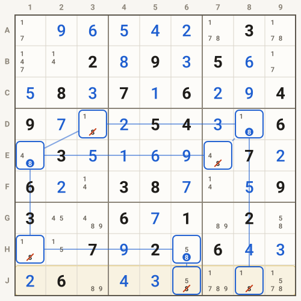

The Rule 2 example of [Simple Colouring](https://www.sudokuwiki.org/Simple_Colouring) on sudokuwiki.org.

`Simple Colouring on 8: J6/J8 twice in row J, eliminates 8 from D3, E7, H1, J6, J8`

> Where a row, column or box has only two places left for 8, one of them is the 8 and the other is not. Linked together, such pairs make a chain with two sides: one side is all 8s and the other has none. J6 and J8 are on the same side yet share row J, which takes only one 8. That side is therefore the false one, so its 8s are removed and the discs are the true side.
<!-- /example:simple-colouring-rule-2 -->

<!-- example:simple-colouring -->
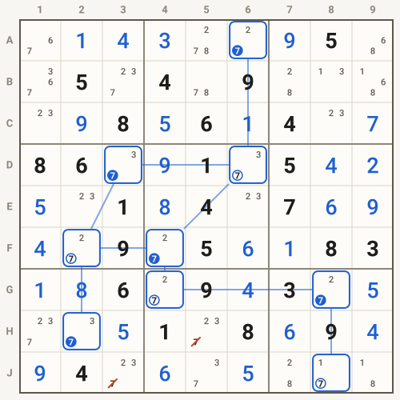

The Rule 4 example of [Simple Colouring](https://www.sudokuwiki.org/Simple_Colouring) on sudokuwiki.org.

`Simple Colouring on 7: A6/D3/F4/G8/H2 against D6/F2/G4/J8, eliminates 7 from H5, J3`

> Where a row, column or box has only two places left for 7, one of them is the 7 and the other is not. Linked together, such pairs make a chain with two sides, discs and rings: one side is all 7s and the other has none. H5 sees a disc (H2) and a ring (G4), and J3 sees a disc (D3) and a ring (J8), so neither can be 7 whichever side is the true one.
<!-- /example:simple-colouring -->

<!-- example:simple-colouring-rule-7 -->
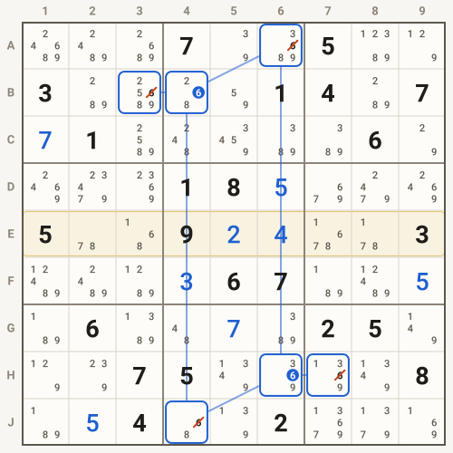

The Rule 7 example of [Simple Colouring](https://www.sudokuwiki.org/Simple_Colouring) on sudokuwiki.org.

`Simple Colouring on 6: B3/H7 empty row E, eliminates 6 from A6, B3, H7, J4`

> Where a row, column or box has only two places left for 6, one of them is the 6 and the other is not. Linked together, such pairs make a chain with two sides: one side is all 6s and the other has none. E3 and E7 are the only places for 6 in row E, and both are in sight of the same side of the chain (B3 and H7): were that side true, row E would have no 6. That side is therefore the false one, so its 6s are removed and the discs are the true side.
<!-- /example:simple-colouring-rule-7 -->

**How the code finds it.** For each digit the code lists its places in each of the 27 units. Every unit with exactly two places gives a link, and a line and a box holding the same two cells give one link. Chains are coloured outwards from their first cell, breadth first. A chain of one link is skipped: all it can remove is what Pointing Pairs and Box-Reduction remove. For each chain the code records which colours every cell of the board sees. Rule 2 applies when a cell of the chain sees a cell of its own colour, and the code then names the unit that holds both. Rule 7 is a unit with two or more places, all off the chain and all in sight of one colour. If both colours fail, the position is broken and the chain gives nothing. Rule 4 collects the cells off the chain that see both colours. The false colour is removed rather than the true one placed, and singles place it next. A chain that removes nothing is dropped; every other chain is one occurrence: the colour left standing as discs (discs and rings when neither colour fails), strikes on the false colour and the Rule 4 cells, every link drawn as a tie, and the unit behind Rule 2 or 7 washed.

**Tests.** The article's examples of rules 2, 4 and 7 (Rule 4 twice, following the chain as it grows; Rule 7 with a pair and with a box of four places), a sweep over every position of 200 solves, a check that every candidate gets one mark and every link has an end of each colour, and near misses: nothing in sight of both colours, a lone pair, and a place out of sight for Rule 7.

### X-Cycles

Tried 21st of 34 · [sudokuwiki.org](https://www.sudokuwiki.org/X_Cycles) ([part 2](https://www.sudokuwiki.org/X_Cycles_Part_2)) · [`xCycles.ts`](../src/core/strategies/xCycles.ts)

X-Cycles look at one digit at a time and join its candidates with two kinds of link. A strong link joins the only two places a row, column or box has left for the digit: if one of them is not the digit, the other is. A weak link joins any two places that share a unit: if one of them is the digit, the other is not. A strong link is also a weak one, since of two places in a unit at most one holds the digit. Links that go round and come back to where they started make a loop, and three rules say what a loop proves. [Simple Colouring](#simple-colouring) follows strong links only; the weak links are what X-Cycles add.

Rule 1, a continuous loop: strong and weak links alternate all the way round, so the loop has an even number of cells. Whichever way the first cell goes, the links carry it round: on, off, on, off. So every link of the loop holds exactly one of the digit, the weak ones included. A cell off the loop that sees both ends of a weak link would sit beside a certain digit, and loses it. An [X-Wing](#x-wing) is a continuous loop of four cells.

<!-- example:x-cycles-rule-1 -->
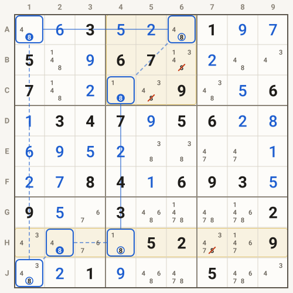

Figure 4 of [X-Cycles](https://www.sudokuwiki.org/X_Cycles) on sudokuwiki.org. The step has 2 occurrences; this is one of them.

`X-Cycle on 8 (rule 1): A1=A6-C4=H4-H2=J1-A1, eliminates 8 from B6, C5, H7`

> The 8s at A1, A6, C4, H4, H2 and J1 make a loop. A solid link joins the only two places a row, column or box has left for the digit, so if one is not it, the other is; a dashed link joins two cells that share a unit, so if one is, the other is not. Here the links alternate all the way round, so the cells are 8 in turn: either A1, C4 and H2 are 8, or A6, H4 and J1 are. Every dashed link then holds exactly one 8 as well. B6 and C5 see both A6 and C4, and H7 sees both H4 and H2, so 8 is removed from B6, C5 and H7.
<!-- /example:x-cycles-rule-1 -->

Rule 2, two strong links meet: the loop alternates everywhere except at one cell, where both its links are strong. Suppose that cell is not the digit. Its first strong link makes the next cell the digit, the alternating links carry that round, and the last strong link comes back and makes the cell the digit after all. That cannot be, so the cell is the digit, and it is placed.

<!-- example:x-cycles-rule-2 -->
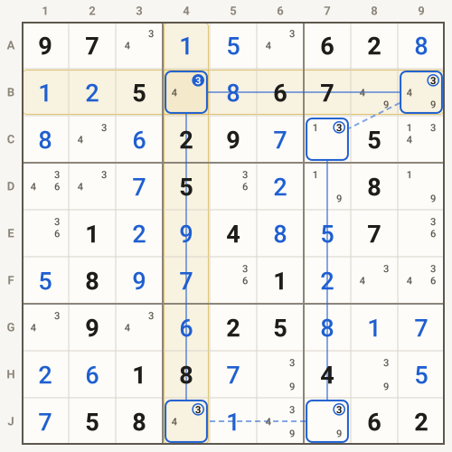

Figure 1 of [X-Cycles, part 2](https://www.sudokuwiki.org/X_Cycles_Part_2) on sudokuwiki.org. The step has 6 occurrences; this is one of them.

`X-Cycle on 3 (rule 2): B4=B9-C7=J7-J4=B4, places 3 in B4`

> The 3s at B4, B9, C7, J7 and J4 make a loop. A solid link joins the only two places a row, column or box has left for the digit, so if one is not it, the other is; a dashed link joins two cells that share a unit, so if one is, the other is not. Two solid links meet at B4. If B4 were not 3, B9 would be (the only other 3 in row B), so C7 would not be (it shares box 3 with B9), so J7 would be (the only other 3 in column 7), so J4 would not be (it shares row J with J7); and then B4 would have to be 3 after all, as the only other 3 in column 4. So B4 is 3.
<!-- /example:x-cycles-rule-2 -->

Rule 3, two weak links meet: the same, with two weak links at the odd cell. Suppose the cell is the digit. The first weak link turns the next cell off, the links carry that round, and the last one arrives as "the digit is here", which the closing weak link says rules out the cell. So the cell loses the digit. Seen another way, the loop without that cell is a chain with a strong link at each end, so one of its two ends is the digit, and every cell that sees both ends loses it; that is how one loop can take the digit from several cells. The five-cell Rule 3 loops are the patterns known as Skyscraper, 2-String Kite and Turbot Fish.

<!-- example:x-cycles-rule-3 -->
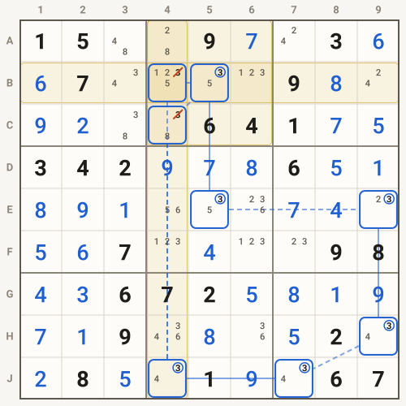

Figure 3 of [X-Cycles, part 2](https://www.sudokuwiki.org/X_Cycles_Part_2) on sudokuwiki.org. The step has 2 occurrences; this is one of them.

`X-Cycle on 3 (rule 3): B4|C4-B5=E5-E9=H9-J7=J4-B4|C4, eliminates 3 from B4, C4`

> The 3s at B4, B5, E5, E9, H9, J7 and J4 make a loop. A solid link joins the only two places a row, column or box has left for the digit, so if one is not it, the other is; a dashed link joins two cells that share a unit, so if one is, the other is not. Two dashed links meet at B4. If B4 were 3, B5 would not be (it shares row B with B4), so E5 would be (the only other 3 in column 5), so E9 would not be (it shares row E with E5), so H9 would be (the only other 3 in column 9), so J7 would not be (it shares box 9 with H9), so J4 would be (the only other 3 in row J); but J4 shares column 4 with B4, so B4 would not be 3 after all. The loop contradicts itself, so 3 is removed from B4. C4 sees both B5 and J4 as well, and loses its 3 the same way.
<!-- /example:x-cycles-rule-3 -->

**How the code finds it.** The search runs digit by digit. It lists the digit's places; every unit with exactly two places gives a strong link (a pair that a line and a box share counts once), and every two places that see each other give a weak link. From each place with a strong link it searches breadth first over the states "cell is off" and "cell is on", starting from "start is off": an off state crosses a strong link to "partner is on", an on state crosses any weak link to "peer is off". Breadth first reaches each state by its shortest chain, the chains alternate by construction, and they stop at 11 links, so loops have at most 12 cells. Reaching "start is on" closes a Rule 2 loop. Reaching any other "on" state gives a chain with a strong link at each end: if its ends see each other, the closing weak link makes a Rule 1 loop and each weak link removes from the places off the loop that see both its ends; if not, every place that sees both ends is a Rule 3 cell. Loops of three cells are left to Box-Reduction. Loops are ranked shortest first (the site's priority since February 2026), then placements before removals, then more removals; a loop is kept only if it does something the ones before it do not, and a step shows at most 12. Strong links are drawn solid and weak links dashed; Rule 1 puts discs and rings on the two ways round, Rule 2 a disc on the cell placed, Rule 3 rings on the chain and strokes on what it removes. The label writes the loop with `=` for strong links and `-` for weak ones.

**Tests.** Figure 4 of part 1, Berthier's eight-cell loop (exactly the nine removals of the picture), and Figures 1 to 3 of part 2. Figure 2 comes out as a placement of 1 in F5 where the article removes 1 from B5: it is the same loop read as Rule 2 at the neighbouring cell, and placing F5 clears B5 too. The 11 exemplars of part 2 are solved with every step checked, there is a sweep over every position of 200 solves, and near misses on a board built for one digit.

**Left out.** Grouped cells as link ends (Grouped X-Cycles, in the site's extreme tier), loops of more than 12 cells, and removals from cells on the loop itself.

### XY-Chain

Tried 22nd of 34 · [sudokuwiki.org](https://www.sudokuwiki.org/XY_Chains) · [`xyChain.ts`](../src/core/strategies/xyChain.ts)

A chain of cells with two candidates each, every cell in sight of the next and sharing one digit with it. A two-candidate cell is one digit or the other, so whatever digit a cell turns out to be, the next cell (which sees it and holds that digit too) cannot be it, and is its other digit. Now let both ends hold the same digit Z, which is not the digit either end passes along. If the first end is not Z it is its other digit, and the chain pushes that along cell by cell until the last end is forced to be Z. So one of the two ends is Z, and any cell that sees both ends loses Z. A [Y-Wing](#y-wing) is the three-cell case; a Remote Pair chain, where every cell holds the same pair, is another.

In the article's first example the chain runs A7 (5/9), A5 (9/2), A1 (2/6) and C2 (6/5): if A7 is not 5 it is 9, so A5 is 2, A1 is 6 and C2 is 5. One of A7 and C2 is 5, and 5 leaves A3, C7 and C9.

<!-- example:xy-chain -->
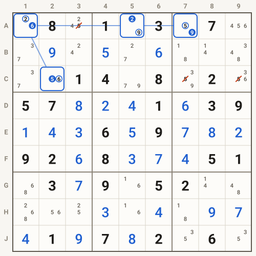

Example 1 of [XY-Chains](https://www.sudokuwiki.org/XY_Chains) on sudokuwiki.org. The step has 2 occurrences; this is one of them.

`XY-Chain on 5: (5=9)A7-(9=2)A5-(2=6)A1-(6=5)C2, eliminates 5 from A3, C7, C9`

> A7, A5, A1 and C2 can each only be one of two digits, and each sees the next and shares a digit with it, so whichever digit a cell is, the next is its other one. If A7 is not 5, it is 9, and then A5 is 2, A1 is 6 and C2 is 5. So A7 or C2 is 5, and 5 is removed from A3, C7 and C9, which see both of them.
<!-- /example:xy-chain -->

A closed chain: when the two ends see each other, the Z they share ties them too and the chain closes into a loop. A loop of two-candidate cells can be filled only two ways: one digit in the first cell fixes every cell going round, the other digit fixes them all the other way. Either way, of every two neighbours on the loop exactly one holds the digit they share. So every link, not only the ends, removes its digit from the cells off the loop that see both of its cells.

<!-- example:xy-chain-closed -->
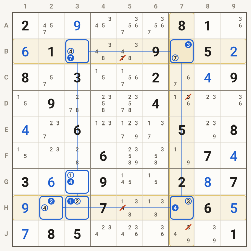

The first closed chain example of [XY-Chains](https://www.sudokuwiki.org/XY_Chains) on sudokuwiki.org. The step has 2 occurrences; this is one of them.

`XY-Chain loop: (4=7)B3-(7=3)B7-(3=4)H7-(4=2)H2-(2=1)H3-(1=4)G3-B3, eliminates 7 from B5, 3 from D7, J7, 4 from H5`

> B3, B7, H7, H2, H3 and G3 can each only be one of two digits, and each sees the next and shares a digit with it, so whichever digit a cell is, the next is its other one. G3 sees B3 as well, which closes the chain into a loop, and a loop goes only two ways round: B3 is 7, B7 is 3, H7 is 4, H2 is 2, H3 is 1 and G3 is 4 (the discs), or B3 is 4, B7 is 7, H7 is 3, H2 is 4, H3 is 2 and G3 is 1 (the rings). Either way, of every two neighbours on the loop exactly one holds the digit they share, so no other cell that sees both can hold it: 7 is removed from B5, which sees B3 and B7; 3 is removed from D7 and J7, which see B7 and H7; 4 is removed from H5, which sees H7 and H2.
<!-- /example:xy-chain-closed -->

**How the code finds it.** It lists the cells with two candidates and, for each, the two-candidate cells it sees. From every such cell, and each of its two digits as Z, it searches breadth first. A state is a cell and the digit it is forced to be, starting from the start cell being its other digit; from a state the search steps to every two-candidate peer holding that digit, which is then forced to its own other digit. A state is reached once (so each end gets its shortest chain), a chain never comes back to a cell already on it, and chains stop at 12 cells, the site's limit. Every state reached that is forced to Z, four cells or more from the start, ends a chain; three cells are left to Y-Wing. When the ends see each other the chain is treated as a loop. Chains are keyed by what they remove and only the shortest is kept for each, since the same loop is found from every cell and both ways round. They are ranked by number of removals, then by length; a chain whose removals are all made by one ranked above it is dropped, and a step shows at most 12. On each chain cell a disc marks the digit it is if the first end is not Z and a ring its other digit, so discs and rings alternate; ties join consecutive cells. The label uses the usual notation, `(5=9)A7-(9=2)A5-...`.

**Tests.** Examples 1 and 2 and both closed examples of the article (the second a four-cell loop removing along three of its four links), the six exemplars solved with every step checked, near misses (a third candidate in a chain cell breaks the chain), and a sweep over every position of 200 solves.

**Left out.** Links through groups of cells, almost locked sets or unique rectangles, as on the site at this level; longer alternatives to a shortest chain, which the breadth first search does not look at; removals from cells on the chain itself.

### 3D Medusa

Tried 23rd of 34 · [sudokuwiki.org](https://www.sudokuwiki.org/3D_Medusa) · [`medusa.ts`](../src/core/strategies/medusa.ts)

Some candidates come in pairs of which exactly one is true. A cell with only two candidates is one such pair; a row, column or box with only two places for a digit is another. [Simple Colouring](#simple-colouring) follows the second kind for one digit. 3D Medusa follows both kinds at once, so a chain of 4s can step through a two-candidate cell into a chain of 9s, and on into 1s and 3s. The result is a web of candidates over several digits, coloured in two sides as it grows: two paired candidates always go on opposite sides. One whole side is true and the other false. Which is which is not known yet, but seven rules either find the false side, or find candidates that go whichever side is true. The rule numbers are the article's.

Four rules show a side is false, and all its candidates are removed. Rule 1, twice in a cell: the side holds two digits of one cell, and a cell takes one digit.

<!-- example:medusa-rule-1 -->
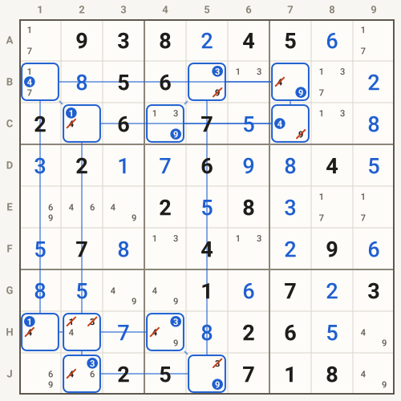

The Rule 1 example of [3D Medusa](https://www.sudokuwiki.org/3D_Medusa) on sudokuwiki.org.

`3D Medusa, rules 1 and 5: 1&3 on one side in H2, eliminates 1 from H2; 3 from H2, J5; 4 from B7, C2, H1, H4, J2; 9 from B5, C7`

> Where a cell has only two candidates left, or a row, column or box only two places left for a digit, one of the two is true and the other is not. Linked up across cells and digits, such pairs make a web with two sides: one side is all true and the other all false. H2 holds 1 and 3 on the same side, yet a cell takes only one digit. That side is therefore the false one, so its candidates are removed and the discs are the true side. Besides, the 4 in H4 sees a 4 on one side (H1) and has the other side in its own cell (the 3); the 4 in J2 sees a 4 on one side (C2) and has the other side in its own cell (the 3): whichever side is true, those candidates are false, so they go too.
<!-- /example:medusa-rule-1 -->

Rule 2, twice in a unit: the side holds the same digit twice in a row, column or box. Rule 7, a unit emptied: every place a unit has left for a digit is off the web and in sight of that digit on one side; were that side true, the unit would have nowhere for the digit. Rule 6, a cell emptied: a cell off the web has every one of its candidates in sight of the same digit on one side; were that side true, the cell would have nothing left.

<!-- example:medusa-rule-6 -->
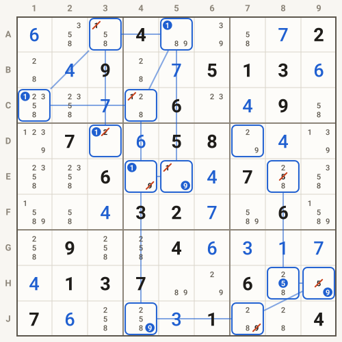

The Rule 6 example of [3D Medusa](https://www.sudokuwiki.org/3D_Medusa) on sudokuwiki.org.

`3D Medusa, rule 6: one side empties D7, eliminates 1 from A3, C4, E5; 2 from D3; 5 from E8, H9; 9 from E4, J7`

> Where a cell has only two candidates left, or a row, column or box only two places left for a digit, one of the two is true and the other is not. Linked up across cells and digits, such pairs make a web with two sides: one side is all true and the other all false. D7 is off the web, and its 2 sees the 2 in D3 and its 9 sees the 9 in J7, all on the same side: were that side true, D7 would have no candidate left. That side is therefore the false one, so its candidates are removed and the discs are the true side.
<!-- /example:medusa-rule-6 -->

Three rules remove a candidate off the web that both sides rule out. Rule 3, a cell holding both sides: whichever side is true, the cell is one of its two coloured digits, so its other candidates go. Rule 4, both sides in sight: the candidate sees its own digit on one side in one cell and on the other side in another. Rule 5, one side in sight and the other in its own cell: one side would take the candidate's digit in a cell it sees, the other side would fill its own cell with a different digit. Rule 5 is the most common Medusa removal on the site.

<!-- example:medusa-rule-5 -->
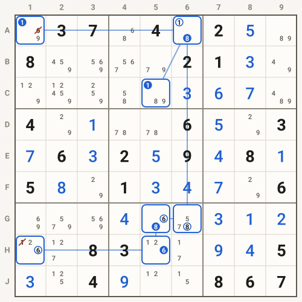

The Rule 5 example of [3D Medusa](https://www.sudokuwiki.org/3D_Medusa) on sudokuwiki.org.

`3D Medusa, rule 5: 2 candidates ruled out by both sides, eliminates 1 from H1; 6 from A1`

> Where a cell has only two candidates left, or a row, column or box only two places left for a digit, one of the two is true and the other is not. Linked up across cells and digits, such pairs make a web with two sides: one side is all true and the other all false. Here the sides are the discs and the rings. The 6 in A1 sees a ring 6 (H1) and has a disc in its own cell (the 1); the 1 in H1 sees a disc 1 (A1) and has a ring in its own cell (the 6). Whichever side is true, these candidates are false, so they are removed.
<!-- /example:medusa-rule-5 -->

Rules 2, 4 and 7 are Simple Colouring's; 1, 3, 5 and 6 need a web that crosses from one digit to another.

**How the code finds it.** Each candidate is a node, numbered by cell and digit. The places each row, column and box has for each digit are listed once, and give the links: a two-candidate cell links its two digits, a unit with two places for a digit links them, and a line and a box sharing the same two places give one link. From every linked candidate not yet in a web, a breadth first walk colours the web, one side for the start and the opposite side for each partner. A web is dropped when two linked candidates land on the same side (the position is already broken), when it is a lone pair, or when it never leaves one digit, which is Simple Colouring's. For each side, one pass over its candidates records, for every candidate on the board, a cell of that side holding the same digit that sees it, and for every cell how many of its candidates are on that side. Rules 1, 2, 6 and 7 are then tested on each side from those tables; if both sides fail, nothing is claimed. Every candidate off the web is checked against both sides for Rules 3 to 5. A web that removes something is one occurrence: the false side struck with the side left standing as discs, or, with no false side, discs and rings for the two sides; caught candidates struck; ties between cells joined by a unit link (the link inside a cell cannot be drawn); the unit behind Rule 2 or 7 washed. A web whose removals an earlier web already makes is left out. The explanation names the rule, then gives the first three catches with their reasons.

**Tests.** Every Load Example of the article, each with exact removals, marks and links. Three differ from the text: in the Rule 1 position H1 holds only 1 and 4, so 4 joins the false side and Rule 5 adds three removals to the article's seven; for Rule 5 the article's text counts four removals where its picture shows two, and the code finds those two; the first Rule 7 example names row B where the article names box 2, both emptied by the same side, with the same removals. Klaus Brenner's position (37 removals in the article, 40 here with three Rule 5 catches), the 12 exemplars, a sweep over 200 solves, and near misses for Rules 6 and 7.

**Left out.** Placing the true side once a side is false, and removing everything the true side sees: the site does neither, and the singles that follow do it. Webs of one digit (Simple Colouring's), Rule 6 for a cell that has candidates on the web, and grouped links.

## Deadly patterns

What would give the puzzle two solutions, or none. These rely on the puzzle having exactly one solution.

### BUG+1

Tried 9th of 34 · [sudokuwiki.org](https://www.sudokuwiki.org/BUG) · [`uniqueness.ts`](../src/core/strategies/uniqueness.ts)

BUG stands for Bi-Value Universal Grave: a position where every unsolved cell has exactly two candidates, and every digit that is still a candidate in a row, column or box is a candidate there exactly twice. Such a grid cannot have exactly one solution. Its candidates pair up all over the board, and the pairs can be settled one way, the other way round, or not at all.

BUG+1 is the position one candidate away from that: every unsolved cell has two candidates except one cell with three. Of those three digits, one is a candidate three times in that cell's row, column and box, and the other two are candidates twice. Without that digit the cell would complete the BUG. So, assuming the puzzle has exactly one solution, the cell is the digit that appears three times, and its other two candidates go.

<!-- example:bug-plus-one -->
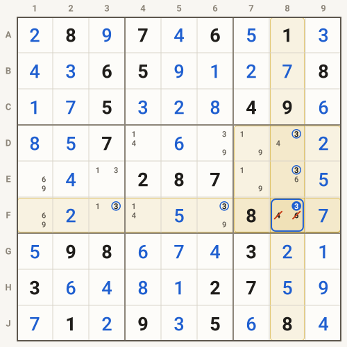

The library puzzle *BUG+1*, after 14 steps.

`BUG+1 in F8: must be 3, eliminates 4/6`

> Every unsolved cell is down to two candidates except F8, which has three. Without the 3 in F8, every digit would be a candidate exactly twice in each row, column and box, and a grid like that can be finished in two ways or not at all, never in just one. Assuming the puzzle has exactly one solution, F8 must be the 3, the digit that appears three times in row F, column 8 and box 6, so 4 and 6 are removed from it.
<!-- /example:bug-plus-one -->

**How the code finds it.** One pass over the board looks for the cell with three candidates. A second cell with three, or any cell with four or more, ends the search at once, so on most positions the strategy costs a single scan. The code then counts how many cells of each row, column and box hold each digit. The extra digit is the one of the three that the odd cell's row holds three times. That digit is taken out of the counts of the odd cell's row, column and box, and every count on the board must now be 0 or 2; anything else means the grid is not a BUG and nothing is returned. The step removes the other two candidates rather than placing the digit, and Naked Singles places it next. It draws a disc on the extra digit, rings on the same digit in the cells of the three units that pair up with it, strikes on the two candidates removed, and washes the cell's row, column and box. There is at most one occurrence.

**Tests.** The article's example (3 is the solution of F8), a sweep over every position of 200 generated solves, and two near misses: a second cell with more than two candidates, and digits that do not pair up once the extra one is gone.

### Unique Rectangles

Tried 11th of 34 · [sudokuwiki.org](https://www.sudokuwiki.org/Unique_Rectangles) · [`uniqueness.ts`](../src/core/strategies/uniqueness.ts)

Four cells at the corners of a rectangle, in two rows, two columns and two boxes, cannot all end up holding the same two digits X and Y. If they did, the Xs and Ys could swap corners and every row, column and box would still hold the same digits: the puzzle would have two solutions. This is the deadly pattern. The rectangle has to lie in exactly two boxes. Spread over four boxes, a swap would change what each box holds, and the argument fails.

Type 1: three corners hold X and Y and nothing else, and the fourth holds X, Y and other candidates. If the fourth corner were X or Y, the deadly pattern would be complete. So, assuming the puzzle has exactly one solution, X and Y are removed from the fourth corner.

<!-- example:unique-rectangles -->
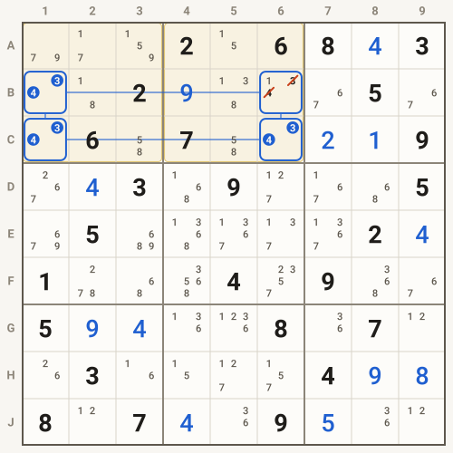

The library puzzle *Unique Rectangles*, after 14 steps.

`Type 1 on 3/4: rows B&C, columns 1&6, eliminates 3/4 from B6`

> B1, C1 and C6 can each only be 3 or 4, and with B6 they are the four corners of a rectangle that lies in just two boxes. If B6 were 3 or 4 too, the corners could swap their 3s and 4s and every row, column and box would still hold the same digits, giving the puzzle two solutions. Assuming it has exactly one, B6 is neither, so 3 and 4 are removed from it.
<!-- /example:unique-rectangles -->

**How the code finds it.** The rectangles are listed once, when the module loads: every two rows and two columns whose four crossings lie in exactly two boxes (the rows in one band and the columns in different stacks, or the other way round). For each rectangle the code checks the corners in turn. Three must be unsolved with exactly two candidates and one must have more; a solved corner, a corner with one candidate, or a second corner with extras ends the check. The three bare corners must hold the same pair, and the fourth must hold both of its digits. The step draws discs on the pair in the three bare corners, strikes the two digits in the fourth, ties the four sides of the rectangle, and washes the two boxes. Each rectangle found is one occurrence, in the order of the list. The list, `RECTANGLES`, is shared with the other rectangle strategies of this family.

**Tests.** Figure 2 of the article (2 and 9 leave D1), a sweep over every position of 200 generated solves, and near misses: a rectangle over four boxes, and corners that are not three bare pairs and a fourth holding both digits.

**Left out.** Types 2 to 5 of the article reason about where the extra candidates (the guardians) must go. They are a separate strategy, tried much later: [Unique Rectangle Guardians](#unique-rectangle-guardians), next to Hidden, Extended and Avoidable Rectangles.

### Unique Rectangle Guardians

Tried 25th of 34 · [sudokuwiki.org](https://www.sudokuwiki.org/Unique_Rectangles) · [`uniqueRectanglesPlus.ts`](../src/core/strategies/uniqueRectanglesPlus.ts)

The deadly pattern of [Unique Rectangles](#unique-rectangles): four cells at the corners of a rectangle in two rows, two columns and exactly two boxes, that can all be a or b. If every corner ended up a or b, the as and bs could swap round the rectangle and the puzzle would have two solutions. So at least one corner ends up with some other digit. Those extra candidates are the guardians, and types 2 to 5 of the article reason about where they must go. Type 1 is [Unique Rectangles](#unique-rectangles). Two corners holding only a and b are the floor; the two with guardians are the roof. Like every deadly pattern, this is only valid for a puzzle with one solution.

Type 2: both roof cells hold a, b and the same one extra digit x. One of them must be x, so x goes from every cell that sees both. With the roof in one box that is its line and its box; across two boxes (2b) its line only. With the guardians on a diagonal (2C), or in three corners, the cells that see all of them lose x.

<!-- example:unique-rectangle-guardians-type-2 -->
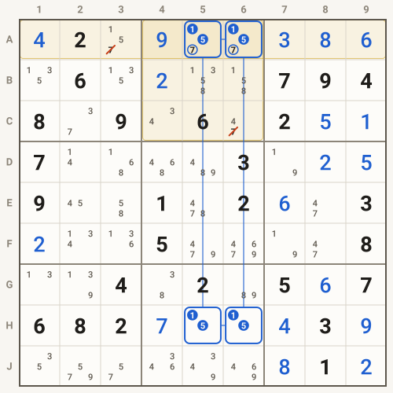

The Type 2 example of [Unique Rectangles](https://www.sudokuwiki.org/Unique_Rectangles) on sudokuwiki.org.

`Type 2 on 1/5: rows A&H, columns 5&6, eliminates 7 from A3, C6`

> A5, A6, H5 and H6 make a rectangle in two boxes, and all four can be 1 or 5. Were each of them one of the two, the 1s and 5s could swap corners and give the puzzle a second solution; assuming it has just one, that cannot happen. H5 and H6 can only be 1 or 5, and the only other digit A5 and A6 hold is 7, so one of them is 7. A3 and C6 see both of them, so 7 is removed from them.
<!-- /example:unique-rectangle-guardians-type-2 -->

Type 2D: the roof cells see each other and the floor is a and b, so the roof holds at most one of the two digits. Every unit the roof shares still needs both a and b, so one of them comes from outside the roof. When only one other cell of that unit can take a or b, that cell is one of them, and its other candidates go.

<!-- example:unique-rectangle-guardians-type-2d -->
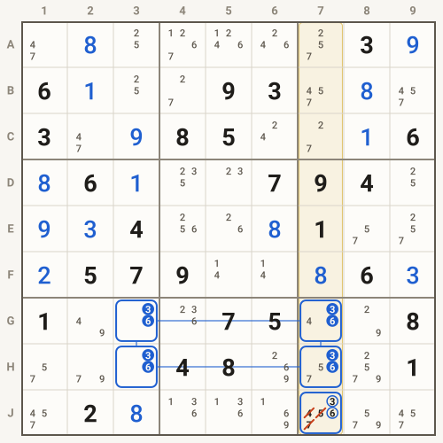

The Type 2D example of [Unique Rectangles](https://www.sudokuwiki.org/Unique_Rectangles) on sudokuwiki.org.

`Type 2D on 3/6: rows G&H, columns 3&7, eliminates 4/5/7 from J7`

> G3, G7, H3 and H7 make a rectangle in two boxes, and all four can be 3 or 6. Were each of them one of the two, the 3s and 6s could swap corners and give the puzzle a second solution; assuming it has just one, that cannot happen. G3 and H3 can only be 3 or 6, so G7 and H7 cannot both be: at most one of the two digits goes into them, yet column 7 needs both, and outside G7 and H7 only J7 can take 3 or 6. So J7 is 3 or 6, and 4, 5 and 7 are removed from it.
<!-- /example:unique-rectangle-guardians-type-2d -->

Type 3 and 3b: with several guardian digits, at least one roof cell takes one of them, so the roof acts as one cell holding all the guardians. Add k other cells of a unit the roof shares that, with the guardians, hold k + 1 digits: a [naked set](#naked-pairs). Those digits leave the rest of the unit. In 3b the roof is in one box, which can hold the set too.

<!-- example:unique-rectangle-guardians-type-3 -->
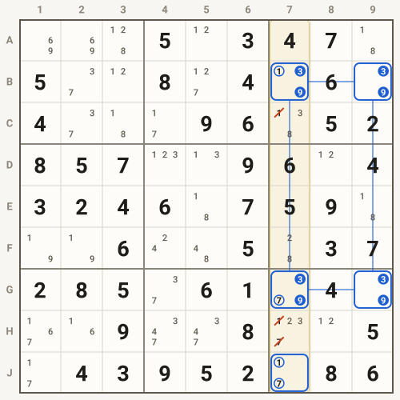

The Type 3 example of [Unique Rectangles](https://www.sudokuwiki.org/Unique_Rectangles) on sudokuwiki.org. The step has 3 occurrences; this is one of them.

`Type 3 on 3/9: rows B&G, columns 7&9, set with J7, eliminates 1 from C7; 1/7 from H7`

> B7, B9, G7 and G9 make a rectangle in two boxes, and all four can be 3 or 9. Were each of them one of the two, the 3s and 9s could swap corners and give the puzzle a second solution; assuming it has just one, that cannot happen. B9 and G9 can only be 3 or 9, so at least one of B7 and G7 is 1 or 7: between them they act as one cell holding 1 and 7. With J7 (1 or 7) that makes two cells of column 7 for just 1 and 7, one digit each, so no other cell of column 7 can take them: 1 is removed from C7 and H7, and 7 from H7.
<!-- /example:unique-rectangle-guardians-type-3 -->

Type 4 and 4b: if a has no place in a unit the roof shares except the two roof cells, one roof cell is a. Were the other b, the rectangle would be deadly, so b goes from both roof cells. Type 4 has the roof in one box, 4b across two.

<!-- example:unique-rectangle-guardians-type-4 -->
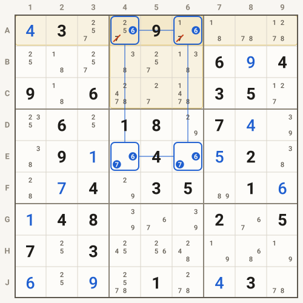

The Type 4 example of [Unique Rectangles](https://www.sudokuwiki.org/Unique_Rectangles) on sudokuwiki.org.

`Type 4 on 6/7: rows A&E, columns 4&6, eliminates 7 from A4, A6`

> A4, A6, E4 and E6 make a rectangle in two boxes, and all four can be 6 or 7. Were each of them one of the two, the 6s and 7s could swap corners and give the puzzle a second solution; assuming it has just one, that cannot happen. E4 and E6 can only be 6 or 7. In row A and box 2, 6 can only go in A4 or A6, so one of them is 6, and were the other 7, all four corners would be 6 and 7. So neither is 7, and 7 is removed from both.
<!-- /example:unique-rectangle-guardians-type-4 -->

Type 5: the floor is on a diagonal, two opposite corners holding only a and b. If, from one of them, the only other places for b in its row and in its column are the two corners beside it, then were it a, both neighbours would be b and the opposite corner, seeing both, would be a: deadly. So it is not a. When both diagonal corners are tied that way by the same digit, both lose the other digit in one step.

<!-- example:unique-rectangle-guardians-type-5 -->
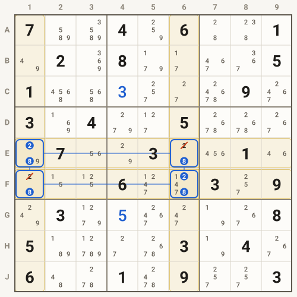

The Type 5 example of [Unique Rectangles](https://www.sudokuwiki.org/Unique_Rectangles) on sudokuwiki.org.

`Type 5 on 2/8: rows E&F, columns 1&6, eliminates 2 from E6, F1`

> E1, E6, F1 and F6 make a rectangle in two boxes, and all four can be 2 or 8. Were each of them one of the two, the 2s and 8s could swap corners and give the puzzle a second solution; assuming it has just one, that cannot happen. E6 and F1, on opposite corners, can only be 2 or 8. The only places for 8 in row E are E6 and E1, and those in column 6 are E6 and F6. Were E6 2, E1 and F6 would both be 8, and F1, which sees both, would be 2: all four corners 2 and 8. F1 is tied to the same two corners by 8 in the same way, so neither E6 nor F1 is 2, and 2 is removed from both.
<!-- /example:unique-rectangle-guardians-type-5 -->

**How the code finds it.** It walks the same list of rectangles as Unique Rectangles (every rectangle that lies in exactly two boxes), skips any with a solved corner, and tries each pair a, b that all four corners still hold. It splits the corners into bare ones (exactly a and b) and guarded ones; three or four bare corners are Type 1's or already deadly. Type 2 needs two or three guarded corners with the same one extra digit, and removes it from the cells that see all of them; the label says 2, 2b or 2C from where the roof lies. Two bare corners on a diagonal go to Type 5, which checks the strong links from each bare corner to both neighbouring corners. With the floor on one side, the roof is the other, and each unit both roof cells share is tried for 2D (how many cells outside the roof can take a or b), 3 (sets of one to three other cells of at most four candidates each, whose digits with the guardians number one more than the set's size, and which are not a naked set on their own) and 4 (a or b with no place in the unit but the roof). Occurrences come in the order 5, 2, 2D, 3, 4, which puts Type 5 first as the site does; one whose removals an earlier one already makes is dropped, and a step shows at most 30. Each draws the rectangle's sides as ties, discs on a and b in the corners, rings on the guardians and on the digits of a Type 3 set, and strokes on the removals.

**Tests.** Every Load Example of the article: types 2 (two), 2b, 2C, 2D (two), 3, 3b, 4, 4b and 5 (two). The article's two "Type 3b with a triple" positions come out as 2D with the same removals, which the article says covers many 3b cases; a position from Klaus Brenner's Exemplar 6 covers a 3b triple and a 3b quad instead. Near misses (a rectangle over four boxes, two different guardians, one strong link for Type 5, a third place for Type 4's digit), the nine exemplars, and a sweep over 200 solves in which every type but 2C turns up.

**Left out.** Type 3 with a hidden set instead of a naked one, naked sets of more than four cells counting the roof, and Type 2 where a roof cell holds two extra digits (that is Type 3's case).

### Avoidable Rectangles

Tried 26th of 34 · [sudokuwiki.org](https://www.sudokuwiki.org/Avoidable_Rectangles) · [`avoidableRectangles.ts`](../src/core/strategies/avoidableRectangles.ts)

Take four cells at the corners of a rectangle in two rows, two columns and exactly two boxes. If they ended up as a, b in one row and b, a in the other, the as and bs could be swapped and the grid would still be valid: a second solution. A puzzle maker prevents that by leaving at least one of the four as a clue. So when none of the four corners is a clue, the solution cannot have that shape. This is the one strategy that learns from which digits were given and which were solved along the way, so it needs the board to know its clues. Like the other deadly patterns, it relies on the puzzle having one solution.

Type 1, the article's rule: three corners are solved, none of them a clue; the two that face each other across the rectangle hold the same digit b and the third holds a. The fourth corner then cannot be a, which would complete the swappable shape. In the article's position A4 = 9, H4 = 7 and H5 = 9 were all solved, not given, so 7 leaves A5. In the picture the solved digits are blue and the clues black.

<!-- example:avoidable-rectangles -->
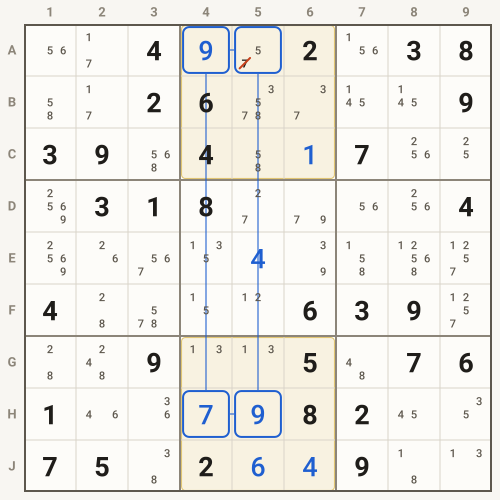

The example of [Avoidable Rectangles](https://www.sudokuwiki.org/Avoidable_Rectangles) on sudokuwiki.org, found by Frisbee.

`Type 1 on 7/9: rows A&H, columns 4&5, eliminates 7 from A5`

> A4, H4 and H5 were solved along the way; none of them is a clue. With A5 they are the four corners of a rectangle that lies in just two boxes, and A4 and H5 across from each other both hold 9. If A5 were 7, like H4 across from it, the corners could swap their 7s and 9s and every row, column and box would still hold the same digits, with no clue changed: the puzzle would have two solutions. It has one, so 7 is removed from A5.
<!-- /example:avoidable-rectangles -->

Type 2, an extension the article does not show: two corners in one line are solved, not clues, holding a and b, and the other two are open, each holding the digit that would complete the shape there plus the same extra digit x. Both taking their shape digit would give the swappable rectangle, so one of them is x. They see each other, so x leaves every other cell that sees both.

**How the code finds it.** Without a clue mask on the board it returns nothing: every value would count as a clue. It walks the list of two-box rectangles from Unique Rectangles and skips any with a clue in a corner. One open corner is Type 1: the corner across from it holds a, the other two must hold the same b, and the open corner must still have a. Two open corners in one line are Type 2: each must hold exactly the value of the corner across from it and one extra digit, the same in both, and the targets are the open cells that see both. Each rectangle and type is one occurrence, with the rectangle's sides as ties; Type 1 strikes the digit in the open corner and washes the two boxes, Type 2 rings the shape digits, puts discs on the extra digit and washes the line.

**Tests.** The article's example (exactly 7 from A5), near misses (no clue mask, a clue in a corner, corners not in the swap shape), Type 2 on the article's position with three cells set as the solution has them, since it never came up in 600 generated solves, and a sweep over 200 solves.

**Left out.** The article's triple pattern over three rows, columns and boxes, for which it gives no removal rule, and the further types other solvers add (pseudo-cells, strong links).

### Tridagons

Tried 27th of 34 · [sudokuwiki.org](https://www.sudokuwiki.org/Tridagons) · [`tridagons.ts`](../src/core/strategies/tridagons.ts)

Take four boxes at the corners of a rectangle: two in one band, two in another, in the same two stacks. In each box pick three cells that use each row and each column of the box once, a slant. A box has six: three rise to the right (the anti diagonal and its two shifts) and three fall (the main diagonal and its shifts). Now suppose the twelve cells of four slants could only hold three digits a, b and c. Each box's slant holds a, b and c once each. Two boxes side by side share their three rows, and no row takes a digit twice, so from one box to the next the digits can only shift round (a to b, b to c, c to a, or the other way), never swap two. The same goes for two boxes one above the other. Following that round the four boxes shows a filling exists only if an even number of the four slants rise. With one rising and three falling, or three and one, the twelve cells cannot be filled from a, b and c at all.

The puzzle has a solution, so at least one of the twelve cells holds something else. Those extra candidates are the guardians. Unlike the rectangles, this needs no assumption that the solution is unique: without a guardian there would be none.

Type 1: only one cell has guardians. It must be one of them, so a, b and c are removed from it.

<!-- example:tridagons -->
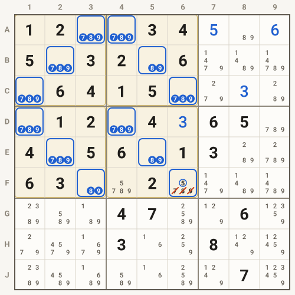

The first Type 1 example of [Tridagons](https://www.sudokuwiki.org/Tridagons) on sudokuwiki.org, the classic from Phil's Folly.

`Type 1 on 7/8/9: boxes 1/2/4/5, guardian F6, eliminates 7/8/9 from F6`

> Twelve cells, three in each of boxes 1, 2, 4 and 5, can only hold 7, 8 or 9, apart from the other candidates of F6. In each box the three cells take one row and one column each, on a slant: from left to right it rises in box 1 and the slants fall in boxes 2, 4 and 5. Boxes side by side can only hold 7, 8 and 9 shifted round from one to the other, never with two of them swapped, and going round the four boxes that leaves no way to fit one slant against the other three: filled from 7, 8 and 9 alone, these cells have no solution. So F6 must be 5, and 7, 8 and 9 are removed from it.
<!-- /example:tridagons -->

Type 2: the guardians are all one digit d, in two or more cells. One of those cells is d, so d goes from every cell that sees all of them (the article's pointing pair of guardians, for any number of guardian cells).

<!-- example:tridagons-type-2 -->
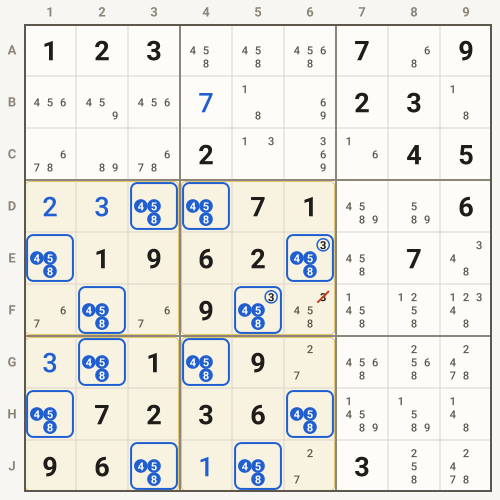

The Type 2 example (a pointing pair of guardians) of [Tridagons](https://www.sudokuwiki.org/Tridagons) on sudokuwiki.org.

`Type 2 on 4/5/8: boxes 4/5/7/8, guardians 3 in E6/F5, eliminates 3 from F6`

> Twelve cells, three in each of boxes 4, 5, 7 and 8, can only hold 4, 5 or 8, apart from the extra candidates in E6 and F5. In each box the three cells take one row and one column each, on a slant: from left to right it falls in box 4 and the slants rise in boxes 5, 7 and 8. Boxes side by side can only hold 4, 5 and 8 shifted round from one to the other, never with two of them swapped, and going round the four boxes that leaves no way to fit one slant against the other three: filled from 4, 5 and 8 alone, these cells have no solution. So one of E6 and F5 must be 3, and 3 is removed from F6, which sees all of them.
<!-- /example:tridagons-type-2 -->

Type 3, the article's 3A and 3B: the guardian cells share a row, column or box. One of them holds a guardian digit, so together they act like one cell whose candidates are the guardian digits. If k other cells of that unit hold digits that, with the guardian digits, number k + 1, the k + 1 "cells" are a [naked set](#naked-pairs) and those digits leave the rest of the unit.

<!-- example:tridagons-type-3 -->
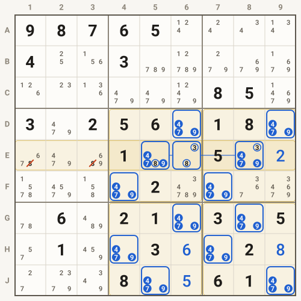

The Type 3A example in a row (a locked pseudo pair) of [Tridagons](https://www.sudokuwiki.org/Tridagons) on sudokuwiki.org.

`Type 3 on 4/7/9: boxes 5/6/8/9, guardians E5/E8 lock 3/8 with E6, eliminates 8 from E1, E3`

> Twelve cells, three in each of boxes 5, 6, 8 and 9, can only hold 4, 7 or 9, apart from the extra candidates in E5 and E8. In each box the three cells take one row and one column each, on a slant: from left to right it falls in box 8 and the slants rise in boxes 5, 6 and 9. Boxes side by side can only hold 4, 7 and 9 shifted round from one to the other, never with two of them swapped, and going round the four boxes that leaves no way to fit one slant against the other three: filled from 4, 7 and 9 alone, these cells have no solution. So one of the extra candidates must be true: 8 in E5 or 3 in E8. E6 can only be 3 or 8. With whichever guardian is true, that makes 2 cells of row E for the 2 digits 3 and 8, which they take between them, so 8 is removed from the rest of row E (E1 and E3).
<!-- /example:tridagons-type-3 -->

**How the code finds it.** Candidates become bit masks. For every box and each of the 84 sets of three digits, it lists the box's slants that fit: three empty cells, each with at least one of the three digits, together holding all three; each slant records whether it rises and which of its cells carry other candidates. The table is built once per call, as each box belongs to four rectangles of boxes. For each of the nine rectangles of boxes and each set of digits, it stops at once if a box has no slant, and otherwise tries every choice of one slant per box, depth first, dropping a branch past four guardian cells, beyond which no type removes anything in practice. A choice with an odd number of rising slants is a tridagon: Types 1, 2 and 3 are tried in that order and the first that removes something is kept, Type 3 with one to three other cells in each unit all guardian cells share. Occurrences with the same removals are dropped. The three digits in the twelve cells are discs, guardians and the candidates of a Type 3 set rings, removals struck, and the four boxes washed. The explanation says which box's slant is the odd one out.

**Tests.** All seven of the article's positions (Type 1 three times, Type 2, Type 3A in a row and in a box, Type 3B), exact except 3B, where the locked triple also takes a 1 from H1. The first position allows two solutions (its From the Start link is another puzzle, as the comments say), and the removal holds in both. Made-up positions check the parity rule: one rising slant against three falling fires, four falling (which a, b, c can fill) does not. The pattern never occurs in 200 generated solves, so the six article puzzles and one from the comments carry the testing, solved with every step checked.

**Left out.** Types 4 and 5, which the article only guesses at; more than four guardian cells; two overlapping tridagons that must both be broken.

### Extended Rectangles

Tried 31st of 34 · [sudokuwiki.org](https://www.sudokuwiki.org/Extended_Unique_Rectangles) · [`extendedRectangles.ts`](../src/core/strategies/extendedRectangles.ts)

The deadly pattern of [Unique Rectangles](#unique-rectangles) one size up: six cells on three digits. Take two columns of one stack and one row in each band. The six cells where they cross sit two to a box, in three boxes, and make two lines of three. (Or turned on its side: two rows of one band and a column in each stack.) If all six ended up holding only a, b and c, each line of three would hold the three digits once, and in every box the two cells could swap: a second solution. So at least one of the six takes another digit. The site calls these Extended Unique Rectangles; like every deadly pattern, they rely on the puzzle having one solution.

Type 1: only one of the six cells has candidates beyond the three digits. It must take one of them, so a, b and c are removed from it. In the article's first example C1 holds 1, 5 and 6 while the other five cells hold only 1, 3 and 5, so C1 is 6.

<!-- example:extended-rectangles-type-1 -->
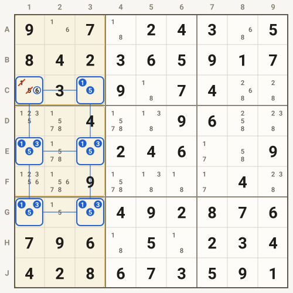

The first Type 1 example of [Extended Unique Rectangles](https://www.sudokuwiki.org/Extended_Unique_Rectangles) on sudokuwiki.org, with the candidates rebuilt from its values.

`Type 1 on 1/3/5: rows C&E&G, columns 1&3, eliminates 1/5 from C1`

> C1, C3, E1, E3, G1 and G3 sit two to a box in boxes 1, 4 and 7, along columns 1 and 3. Apart from C1, they can only be 1, 3 or 5. Were all six left with only those three, columns 1 and 3 would each hold 1, 3 and 5, and the two cells in each box could swap their digits: every row, column and box would still hold the same digits, and the puzzle would have two solutions. Assuming the puzzle has exactly one solution, C1 must be its other candidate, 6, so 1 and 5 are removed from it.
<!-- /example:extended-rectangles-type-1 -->

Type 2: two or three cells have extras, all the same one digit x. One of them is x, so x goes from every other cell that sees all of them.

<!-- example:extended-rectangles-type-2 -->

The Type 2 example of [Extended Unique Rectangles](https://www.sudokuwiki.org/Extended_Unique_Rectangles) on sudokuwiki.org.

`Type 2 on 2/3/4: rows B&E&G, columns 1&2, eliminates 6 from G3, G5, H1`

> B1, B2, E1, E2, G1 and G2 sit two to a box in boxes 1, 4 and 7, along columns 1 and 2. Apart from G1 and G2, they can only be 2, 3 or 4. Were all six left with only those three, columns 1 and 2 would each hold 2, 3 and 4, and the two cells in each box could swap their digits: every row, column and box would still hold the same digits, and the puzzle would have two solutions. The only digit G1 and G2 hold besides the three is 6. Assuming the puzzle has exactly one solution, one of them must be 6, so 6 is removed from every other cell that sees both: G3, G5 and H1.
<!-- /example:extended-rectangles-type-2 -->

Type 4: exactly two cells have extras, they share a unit, and in that unit one of the three digits, u, has no place but those two cells. One of them is u. Were the other also one of the three digits, all six cells would hold only a, b and c, so the other takes an extra, and neither cell can be a digit of the three other than u.

<!-- example:extended-rectangles-type-4 -->

Pieter's Type 4 example of [Extended Unique Rectangles](https://www.sudokuwiki.org/Extended_Unique_Rectangles) on sudokuwiki.org, after the naked pair and naked triple its link leaves to do.

`Type 4 on 1/3/4: rows D&F, columns 3&5&7, strong 1s in column 7, eliminates 3 from D7, F7`

> D3, D5, D7, F3, F5 and F7 sit two to a box in boxes 4, 5 and 6, along rows D and F. Apart from D7 and F7, they can only be 1, 3 or 4. Were all six left with only those three, rows D and F would each hold 1, 3 and 4, and the two cells in each box could swap their digits: every row, column and box would still hold the same digits, and the puzzle would have two solutions. There are only two places for 1 in column 7, D7 and F7, so one of them is 1. Were the other 3 or 4, all six cells would hold only 1, 3 or 4. Assuming the puzzle has exactly one solution, the other one takes a digit outside the three, so neither can be 3 or 4: 3 is removed from D7 and F7.
<!-- /example:extended-rectangles-type-4 -->

**How the code finds it.** The 486 possible blocks of six cells are built once (for each stack, each of its three pairs of columns, and each choice of one row per band; then the same with rows and columns exchanged), with their two lines of three and their three boxes. A block with a solved cell is skipped at once, which ends most calls. For each set of three digits held in the block, the cells with candidates outside the set are the cells with extras; the set counts only if one to three cells have extras, the other cells hold exactly the three digits between them, and each cell with extras holds at least one of the three. One cell with extras is Type 1. Two or three with the same single extra digit is Type 2, if some cell sees them all and holds it. Exactly two is tried as Type 4 for every unit they share and every digit of the three with exactly two places in that unit. Occurrences come in the order 1, 2, 4; one whose removals an earlier one already makes is dropped, and a step shows at most 12. The three digits in the six cells are discs, what saves the pattern (the extras, or u for Type 4) rings, removals struck; ties draw a ladder through the six cells, and the three boxes are washed.

**Tests.** Every example of the article: Type 1 three times (two upright, one on its side), Type 2 and Type 4, each with the article's removals exactly. Four of them are given as digits only, so their candidates are rebuilt and a few basic steps (a naked pair, a naked triple, a pointing pair) bring them to the article's picture first. Near misses (two rows in one band, a solved cell, four digits in the plain cells, different extras, a third place for Type 4's digit), and a sweep over 200 solves.

**Left out.** The full three by three pattern, which the article says need not be searched (any two by three part of it is already deadly); a Type 3, which the article does not describe here; Type 2 over more than three cells.

### Hidden Rectangles

Tried 32nd of 34 · [sudokuwiki.org](https://www.sudokuwiki.org/Hidden_Unique_Rectangles) · [`hiddenRectangles.ts`](../src/core/strategies/hiddenRectangles.ts)

A rectangle in two boxes whose four corners all hold a and b must not end up with only a and b, or they could swap. [Unique Rectangles](#unique-rectangles) need three corners holding only the pair. A hidden rectangle makes do with one or two such corners, the others cluttered with other candidates, and strong links (a digit with only two places in a unit) that would force the corners into the deadly pattern if one particular candidate were true. That candidate is removed. The site calls these Hidden Unique Rectangles; they rely on the puzzle having one solution.

Type 1: one corner holds only a and b. In the opposite corner X, a has only two places in X's row (X and the corner beside it) and only two in X's column (X and the corner above or below it). If X were b, both strong links would put a in the two neighbouring corners, and the first corner, seeing both, would be b: the deadly pattern. So b is removed from X. In the article's example F3 holds 6/8, and the 6s of row H and column 1 are strong links at H1, so H1 loses 8.

<!-- example:hidden-rectangles-type-1 -->

The Type 1 example of [Hidden Unique Rectangles](https://www.sudokuwiki.org/Hidden_Unique_Rectangles) on sudokuwiki.org. The step has 2 occurrences; this is one of them.

`Type 1 on 6/8: rows F&H, columns 1&3, strong 6s in row H and column 1, eliminates 8 from H1`

> F3 can only be 6 or 8, and with F1, H1 and H3 it makes the corners of a rectangle in two boxes, all of which hold 6 and 8. Were the four left with only 6 or 8, the 6s and 8s could swap places and the puzzle would have two solutions. There are only two places for 6 in row H, H1 and H3, and only two in column 1, F1 and H1. Suppose H1 were 8: the 6s would go to H3 and F1, and F3, which sees both, would be 8. The four corners would then hold 6 and 8 alone, in the pattern that can swap. Assuming the puzzle has exactly one solution, H1 is not 8, so 8 is removed from it.
<!-- /example:hidden-rectangles-type-1 -->

Type 2: two corners in a line, the floor, both hold only a and b, and one floor corner shares a strong link on a with the roof corner across from it. If the other roof corner were b, the floor corner in line with it would be a, the linked floor corner b, and the strong link would put a in the linked roof corner: deadly again. So b leaves the other roof corner. Strong links on both digits give two removals from one rectangle, the article's double.

<!-- example:hidden-rectangles-type-2 -->

The Type 2 example of [Hidden Unique Rectangles](https://www.sudokuwiki.org/Hidden_Unique_Rectangles) on sudokuwiki.org.

`Type 2 on 1/8: floor C2/C3, roof J2/J3, strong 1s in column 2, eliminates 8 from J3`

> C2 and C3 can each only be 1 or 8, and with J2 and J3 they make the corners of a rectangle in two boxes, all of which hold 1 and 8. Were the four left with only 1 or 8, the 1s and 8s could swap places and the puzzle would have two solutions. There are only two places for 1 in column 2, C2 and J2. Suppose J3 were 8: C3, in column 3 with it, would be 1, so C2 would be 8, and the 1 of column 2 would go to J2. The four corners would then hold 1 and 8 alone, in the pattern that can swap. Assuming the puzzle has exactly one solution, J3 is not 8, so 8 is removed from it.
<!-- /example:hidden-rectangles-type-2 -->

Type 2b is the same with the floor spanning the two boxes instead of lying in one.

<!-- example:hidden-rectangles-type-2b -->

The first Type 2b example of [Hidden Unique Rectangles](https://www.sudokuwiki.org/Hidden_Unique_Rectangles) on sudokuwiki.org, with the candidates rebuilt from its values.

`Type 2b on 1/7: floor E2/H2, roof E3/H3, strong 1s in box 4, eliminates 7 from H3`

> E2 and H2 can each only be 1 or 7, and with E3 and H3 they make the corners of a rectangle in two boxes, all of which hold 1 and 7. Were the four left with only 1 or 7, the 1s and 7s could swap places and the puzzle would have two solutions. There are only two places for 1 in box 4, E2 and E3. Suppose H3 were 7: H2, in row H with it, would be 1, so E2 would be 7, and the 1 of box 4 would go to E3. The four corners would then hold 1 and 7 alone, in the pattern that can swap. Assuming the puzzle has exactly one solution, H3 is not 7, so 7 is removed from it.
<!-- /example:hidden-rectangles-type-2b -->

**How the code finds it.** It walks the list of two-box rectangles from Unique Rectangles and skips any with a solved corner. A corner with exactly two candidates gives the pair, and every corner must hold both of its digits. For Type 1, with each digit of the pair as a in turn, the opposite corner must share a strong link on a with each of its two neighbours, checked in the row, column or box the two cells share. For Type 2, a second corner in line with the first holding the same pair makes a floor; for each floor corner and each digit, a strong link to the roof corner across from it removes the other digit from the roof corner across from the other floor corner (2b when the floor's cells are in different boxes). An occurrence whose removals were already made is dropped, so a rectangle found from two corners shows once. The strong links are drawn solid, and the ties that close the argument dashed; discs mark the pair in the plain corners, rings the linked digit, and the removal is struck.

**Tests.** Every example of the article, each sound: Type 1 (H1 loses 8, with the article's next Type 2 found in the same position), Type 2, the double, Type 2b given as digits only, and Klaus Brenner's Type 2b. Near misses (a third place for a strong link's digit, a third candidate in a floor cell) and a sweep over 200 solves.

**Left out.** Nothing of the article. A floor whose second cell holds more than the pair is not tried; the article's examples do not use one.
